# HỘI LƯU R5 - HỒ SƠ BÀN GIAO ĐÁNH GIÁ NGOẠI QUAN

**30/09/2026 | Đơn vị m, m² | Tổng hợp R1–R4 + R6-CROWN | Phương án kiến trúc để đánh giá**

> Cơ sở ngoại quan: A/D M2 (R3), B/C K2 (R4), crown và vùng kết thúc theo **R6-CROWN** (REV-C01…C08, chủ đầu tư chỉ đạo). R6 nâng đỉnh kiến trúc A lên +519,54 m (envelope +520,00) và D lên +309,96 m (envelope +310,00); B/C giữ đầu bài H02, đỉnh +159,90 m. Không đổi sàn, mái, lõi hay GFA. Chưa ghi nhận phê duyệt cuối; chưa xác nhận hệ chịu lực, gió, BMU hay tĩnh không.

## Mục lục

- 01. Đề nghị đánh giá và cách đọc hồ sơ
- 02. Thứ tự nguồn chuẩn và trạng thái quyết định
- 03. Vision: một gia đình, bốn vai trò
- 04. Đầu bài, tọa độ và tổng mặt bằng
- 05. Ngân sách diện tích: ngoại quan không được làm sai bảng tính
- 06. A: khung hình học và lịch tầng làm nền cho mặt dựng
- 07. A: mặt dựng M2 và crown "Hội lưu" (R6)
- 08. D: khung hình học, chuyển công năng và mặt dựng
- 09. B/C: footprint, cơ cấu duplex và cao độ
- 10. B/C: ngoại quan K2 và trải nghiệm trong căn
- 11. B/C: crown, kỹ thuật và giới hạn tầm nhìn
- 12. Khối đế, quảng trường và mall: giao diện ngoại quan
- 13. Hầm chung và tải tiếp đất
- 14. Khung chịu lực: ý đồ và điểm phải phối hợp
- 15. Lõi R2: không gian mà kiến trúc phải dành và giới hạn
- 16. Kiểm tra kính và khả năng chế tạo
- 17. Vật liệu, chiếu sáng và các giao diện mặt dựng
- 18. Ma trận ràng buộc dùng khi đề xuất thay đổi
- 19. Các vấn đề cần bên đánh giá trả lời
- 20. Yêu cầu sản phẩm đánh giá và tiêu chí đối chiếu
- 21. Điểm mở, nguồn tham chiếu và danh mục bàn giao

## 01. Đề nghị đánh giá và cách đọc hồ sơ

HỘI LƯU là nghiên cứu một cụm mixed use bốn tháp trên ô đất 295 × 155 m. Hồ sơ này bàn giao phương án ngoại quan cùng khung hình học, công năng và các giao diện kết cấu mà ngoại quan phải phối hợp. Mục tiêu là để một đơn vị chưa tham gia quá trình thiết kế có thể tái dựng, đánh giá và phản biện trên cùng cơ sở dữ liệu.

Phương án tham chiếu để đánh giá: A/D theo hướng M2 của R3; B/C theo hướng K2 của R4; crown, vùng chuyển cận đỉnh, dải kỹ thuật và chiếu sáng đêm theo R6-CROWN. Đây là đề xuất thiết kế hiện tại, chưa ghi nhận phê duyệt cuối của chủ đầu tư. R5 là bản đóng gói và diễn giải nguồn R1–R4. R6-CROWN là lần sửa ngoại quan duy nhất trên nền đó: chỉ đổi crown, mặt dựng cận đỉnh và đỉnh kiến trúc; không đổi biên sàn, cao độ tầng, lõi hoặc ngân sách diện tích.

Yêu cầu bên đánh giá: nhận xét chất lượng hình khối và mặt dựng; khả năng đáp ứng sử dụng; khả năng chế tạo, lắp dựng và bảo trì; các xung đột với kết cấu, MEP, giao thông đứng, PCCC và ngân sách. Mọi đề xuất đổi vị trí, sàn, lõi hoặc diện tích phải ghi tác động trước/sau để chủ đầu tư lựa chọn.

Đọc PDF/Markdown này trước. Mở hai HTML R3/R4 để phóng lớn hình và xem biến thể. Dùng JSON/CSV khi đo, dựng model hoặc kiểm tra con số. Bộ R2 đầy đủ được giữ để tra cơ sở lõi và hình học; OBJ nằm trong source-r 1 chỉ là khối tham chiếu cũ.

| Phạm vi | Đã có trong bộ hồ sơ | Chưa được xác lập |
| --- | --- | --- |
| Kiến trúc | Tâm tháp, lịch tầng, biên sàn, crown; mặt dựng M2/K2 | Mặt bằng phòng chi tiết, shop drawing và duyệt cuối |
| Khung cấu trúc | Đường truyền lực định hướng; vùng lõi, vùng liên kết và giao diện | Phân tích chịu lực, tiết diện cột/tường/dầm, móng |
| Hệ thống | Vùng kỹ thuật, mô hình thang R2, phân tầng hầm | Công suất MEP, ram thực, ô xe, cấu tạo PCCC |
| Pháp lý địa điểm | Các giới hạn do đầu bài cung cấp | Quy hoạch, hướng Bắc, địa chất, đường công cộng |

## 02. Thứ tự nguồn chuẩn và trạng thái quyết định

Khi nguồn khác nhau, áp dụng thứ tự theo phạm vi nội dung, không lấy revision mới hơn để thay toàn bộ revision cũ. Dữ liệu R3/R4 phát triển ngoại quan trên vỏ sàn R1/R2; không sửa lõi, số tầng hoặc ngân sách. R6-CROWN chỉ thay công thức crown R1 (A/D), cao độ đỉnh kiến trúc A/D/B/C và các trường mặt dựng liệt kê trong `facade-crown-r6.json → supersedes`; mọi trường khác của R1–R4 giữ nguyên hiệu lực.

Các bản vẽ là cách trình bày tọa độ. Không đo ngược từ PNG, phối cảnh hoặc ảnh GenAI để sửa biên sàn. Nếu dựng bằng đường cong trơn thay cho đa giác 256 nút, phải báo chênh hình học và diện tích.

| Mã trạng thái | Cách sử dụng trong đánh giá |
| --- | --- |
| H - đầu bài | Điều kiện người dùng cung cấp. Không tự thay; nếu bất khả thi phải nêu xung đột và phương án xử lý. Không coi đây là xác nhận pháp quy. |
| B - cơ sở so sánh | Hình học/budget đang dùng. Giữ trong phương án đánh giá cơ sở; được đề nghị thay khi có bảng tác động và quyết định riêng. |
| P - đề xuất | Ngôn ngữ mặt dựng và kích thước concept. Được phản biện, tinh chỉnh khi bảo toàn ý đồ và báo ảnh hưởng. |
| O - còn mở | Chưa giải hoặc chưa kiểm chứng. Cần nghiên cứu; không được điền giá trị tùy ý rồi trình bày như thông số đã chốt. |

| Ưu tiên | Nguồn | Phạm vi quyết định |
| --- | --- | --- |
| 1 | Đầu bài / H | Đất, FAR, mật độ, giới hạn căn hộ, công năng và riêng tư |
| 2 | geometry-r 2.json / r 2-study.json | Lõi R2, lỗ mở sửa, mall B1 và cấu hình thử thang |
| 3 | Nguồn R1 và duplex-source.json | Biên sàn/cao độ/budget không sửa; B/C, loggia, void, phân căn |
| 4 | facade-crown-r6.json + crown-R6-AD-*.csv | Crown A/D/B/C, đỉnh kiến trúc, vùng chuyển A90–A98/D56–D62, gân/fin cận đỉnh, dải kỹ thuật, chiếu sáng đêm (ghi đè đúng các trường liệt kê trong `supersedes`) |
| 5 | facade-ad-r 3.json | Gân thân, lưới panel A/D, palette, kiểm tra kính (trừ phần R6 ghi đè) |
| 6 | facade-bc-r 4.json | Nhịp duplex, gân góc, lưới panel B/C và kiểm tra nhìn (trừ crown/đỉnh R6) |
| 7 | Báo cáo, SVG, HTML, OBJ cũ | Trình bày và tham khảo; không ghi đè nguồn 1–6 |

## 03. Vision: một gia đình, bốn vai trò

Cụm tháp phải đọc được thành một tổng thể có chủ đích, với quảng trường chéo tạo đường dẫn và khoảng thở giữa các chương trình. A là landmark cao trội; D là đối trọng thấp hơn mang bản sắc khách sạn; B/C là đôi tháp ở riêng tư, có tỷ lệ và chiều sâu phù hợp đời sống duplex cao cấp.

Ngôn ngữ chung: đường đứng có phân cấp; vỏ thu dần có quy luật ở A/D; gân chủ đạo nối liền thân và crown; kính trung tính, kim loại satin ấm và vật liệu khoáng sáng ở phần tiếp đất. Đồng bộ bằng tỷ lệ, đường nét, vật liệu và cách kết thúc, không nhân bản nguyên hình A vào ba tháp còn lại.

Ở xa: A chi phối skyline, D phụ trợ, B/C tạo lớp chiều cao cư trú. Ở quảng trường: thấy chiều sâu gân, hốc loggia và các cửa sảnh rõ ràng. Trong căn hộ: khẩu độ nhìn và ánh sáng được giữ; lớp biểu đạt bên ngoài không biến thành một màn lam đặc chắn mọi căn.

Nguồn cảm hứng SOM là phương pháp tích hợp hình học, kết cấu, mặt dựng và công năng. HỘI LƯU là nghiên cứu độc lập, không phải hồ sơ do SOM lập, phê duyệt hoặc bảo chứng. Không kế thừa các tuyên bố hiệu suất của công trình tham chiếu.

| Tháp | Vai trò hình ảnh | Biểu đạt cần giữ |
| --- | --- | --- |
| A | Điểm nhấn 520 m (R6) | Gân mạnh; thân thu liên tục; vùng chuyển A90–A98; crown "Hội lưu" gồm 4 mũi nhọn hội tụ về 4 rãnh |
| D | Đối trọng 310 m (R6) | Gân nhẹ hơn; nhịp khách sạn rộng; một khoảng lùi D35; crown nghiêng, mũi nhọn duy nhất hướng về A |
| B/C | Đôi tháp ở 159,9 m | Khung hai tầng, gân góc, loggia lõm và khẩu độ khách rộng; crown khung mở, vùng kết thúc L36 → đỉnh |

Ý đồ crown R6: tên Hội Lưu (hợp lưu) được đọc thành hình. Bốn rãnh nông của thân A là bốn dòng chảy; mỗi cặp gân chính hai bên một rãnh hội tụ lên trời thành một mũi nhọn có khe mở ở đỉnh. D đáp lại bằng một mũi nhọn duy nhất quay về A, nên skyline hạ dần một đường liền từ đỉnh A xuống đỉnh D. B/C giữ vai trò nền cư trú, kết thúc bằng khung mở tiết chế trong giới hạn đầu bài.

- Loại bỏ bốn hộp cao dần, khối domino trên một đế chung hoặc các dấu cắt tùy tiện để tạo điểm nhấn.
- Không để crown thành một chiếc mũ gắn lên mái: crown R6 bắt đầu từ vùng chuyển trên thân và dùng lại chính gân/rãnh của thân. Không thêm chóp đơn (spire), tầng ở ẩn hoặc cầu nối trên mặt đất A–D.
- Không để căn hộ thành mặt tường đục lỗ, ban công treo ngẫu nhiên, dàn nóng lộ hoặc LED kẻ từng tầng.

### B01. Gia đình bốn tháp (R6)

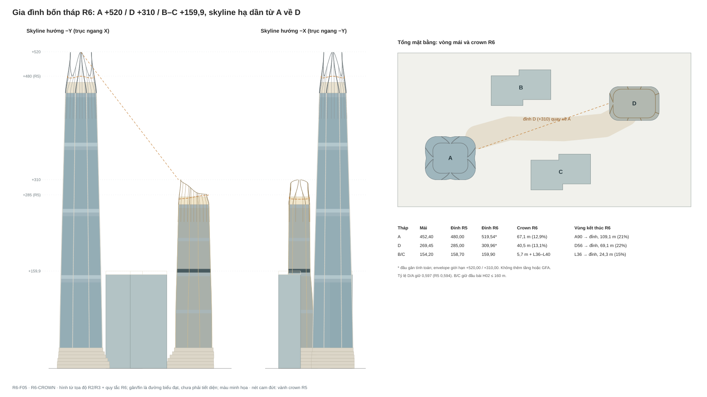

Đọc thứ bậc A520 / D310 / B–C159,9 m; tỷ lệ D/A giữ 0,597 (R5 0,594). Nét cam đứt là vành crown R5 để so. Silhouette dựng từ vòng panel nguồn và quy tắc R6; gân và màu là biểu đạt sơ đồ, không phải mô phỏng vật liệu.

### B01b. Phối cảnh chiếu song song từ tọa độ

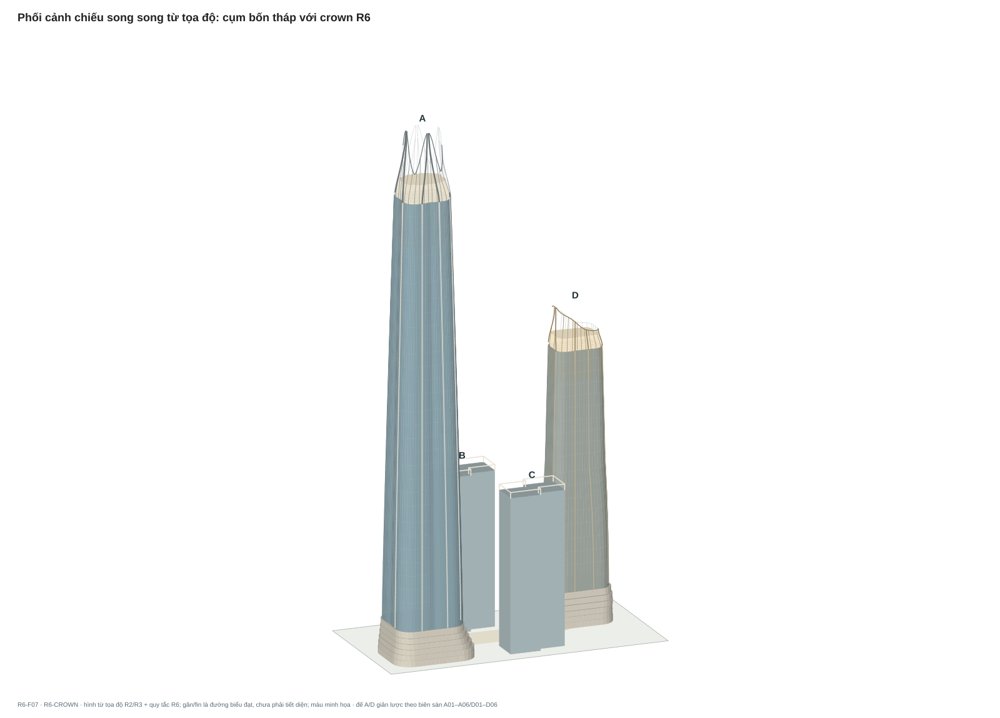

Chiếu song song từ phía −X/−Y. Đế A/D giản lược theo biên sàn A01–A06/D01–D06; B/C là khối đường bao với khung crown mở. Không phải render vật liệu.

## 04. Đầu bài, tọa độ và tổng mặt bằng

H01: ô đất 295 × 155 m, diện tích 45.725 m²; FAR tối đa 14; mật độ tối đa 40%. H02: hai tháp căn hộ tối đa 40 tầng và 160 m; tổng căn hộ không quá 800. H03: mixed use gồm văn phòng, khách sạn, thương mại dịch vụ và căn hộ cao cấp toàn duplex.

H04: mall B1 chạy dưới quảng trường chéo, nối đế A/D; không nối mall vào đế B/C. B2–B5 chỉ xe/kỹ thuật. Hầm chung có thể phục vụ các nhóm, nhưng tuyến cư dân phải độc lập và kiểm soát; không dùng mall làm lối vào nhà.

Gốc (0;0) tại góc đất; X dọc cạnh 295 m, Y dọc cạnh 155 m, Z hướng lên, cốt tiếp cận giả định ±0,00. Chưa có phương vị địa lý. Các ký hiệu +X/−Y trên bản vẽ không tương đương Đông/Tây/Nam/Bắc.

Tim quảng trường: (80;70) → (112;79) → (167;78) → (208;82) → (229;93). Bề rộng băng mặt đất cơ sở 24 m, cắt khỏi đế và buffer riêng tư B/C. Buffer 6 m là giả định tổ chức riêng tư, chưa phải khoảng cách pháp quy.

| Tháp | Tâm X;Y | Biên chân thân m² | Tầng vật lý | Mái / đỉnh m |
| --- | --- | --- | --- | --- |
| A | 53;49 | 4.359,57 | 98 = 6 đế + 92 thân | 452,40 / 519,54 (envelope 520,00; R5 480,00) |
| B | 124;120 | 1.824,00 | 40, gồm 5 đế | 154,20 / 159,90 (R5 158,70) |
| C | 164;35 | 1.824,00 | 40, gồm 5 đế | 154,20 / 159,90 (R5 158,70) |
| D | 238;104 | 2.756,09 | 62 = 6 đế + 56 thân | 269,45 / 309,96 (envelope 310,00; R5 285,00) |

| Khoảng cách chân thân | m | Hàm ý cần đánh giá |
| --- | --- | --- |
| A–B | 26,19 | Ưu tiên riêng tư, kính, view, gió chân tháp |
| A–C / A–D | 46,00 / 122,27 | Quan hệ khoảng trống và skyline |
| D–C / D–B | 34,87 / 54,00 | View căn hộ và hoạt động khách sạn |
| B–C | 55,58 | Nhìn đối diện và phân cấp loggia |

### B02. Vị trí, đế và quảng trường

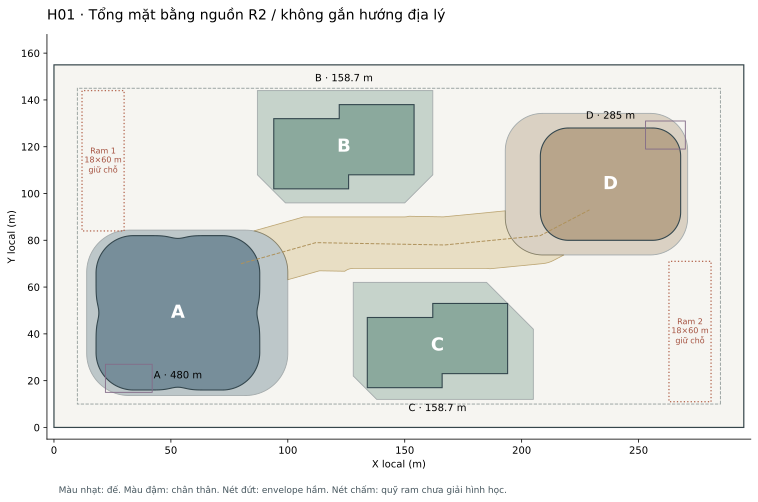

Tổng mặt bằng dùng polygon R2 và chân thân nguồn. Không có hướng Bắc địa lý. Cửa tiếp cận, ram và đường công cộng chưa được chốt.

## 05. Ngân sách diện tích: ngoại quan không được làm sai bảng tính

B01: tổng sàn kiểm soát 631.690,24 m², FAR 13,81499; còn 8.459,76 m² tới trần 640.150 m². Chưa phân bổ dự phòng này cho thiết kế ngoại quan. Không tự thêm tầng, sàn sky garden, sàn crown hoặc lấp void bằng cách viện dẫn còn FAR.

Quy ước nghiên cứu: diện tích polygon sàn trừ lỗ/khuyết xác định; giữ diện tích lõi/giếng/kỹ thuật theo cách bảo thủ. Mall B1 được tính trong FAR kiểm soát. Chưa xác nhận cách phân loại FAR pháp lý tại địa điểm, NLA thuê, diện tích bê tông hoặc BOQ.

B02: mật độ kiểm soát 17.756 / 45.725 = 38,83%; trần 18.290 m², còn 534 m². Tổng đã gồm 400 m² dự trù công trình phụ chưa có tọa độ. Biên đế chiếm đất khác diện tích sàn sau trừ lỗ; không cộng trùng thân tháp nằm trong đế.

Sàn trên mặt đất 617.690,24 m². Đường bao năm tầng hầm 185.625 m². Tổng quy mô hình học 803.315,24 m² chưa trừ đầy đủ lỗ ram/giếng hầm; không dùng làm khối lượng xây dựng hoặc mua kính.

| Gói sàn kiểm soát | m² |
| --- | --- |
| Thân A | 300.000,00 |
| Thân D: văn phòng / khách sạn | 70.000,00 / 50.000,00 |
| Đế A / D | 28.000,00 / 22.000,00 |
| Thân B/C, cả hai | 119.690,24 |
| Đế B/C, cả hai | 28.000,00 |
| Mall B1 | 14.000,00 |
| Tổng / dự phòng FAR | 631.690,24 / 8.459,76 |

| Chiếm đất | A | D | B | C | Phụ trợ |
| --- | --- | --- | --- | --- | --- |
| Đế tầng một, m² | 5.800 | 4.500 | 3.456 | 3.600 | 400 |

## 06. A: khung hình học và lịch tầng làm nền cho mặt dựng

B03: A không xoay theo tầng, thân thu liên tục có bốn rãnh lõm nông. Hạt giống chân thân 70 × 66 m, R16; biên thực gồm rãnh và đa giác 256 nút. Không lấy W/H hạt giống làm hình chữ nhật bao chính xác sau biến dạng. Mái nằm tại +452,40 m (không đổi); đỉnh kiến trúc ngoài cùng R6 là +519,54 m, trong envelope +520,00 m (R5: +480,00 m).

Thân từ A07 đến A98; ngân sách 300.000 m² gồm các tầng hỗ trợ/kỹ thuật. A07 là sky lobby/support. Văn phòng bố trí theo bốn vùng; các cụm kỹ thuật/sky lobby không được dùng để cộng thêm sàn ngoài lịch.

Thứ tự nút vòng biên phải giữ giữa tầng. Loft từ các vòng đã tính; không dùng modifier làm đổi profile nhưng giữ nguyên bảng GFA. Cột biên nghiêng theo hình học cần được phân tích; lõi định hướng đứng, không tự kéo lõi lệch theo vỏ.

| Tầng / nhóm | Cốt bắt đầu m | Cao tầng m | Vai trò giao diện |
| --- | --- | --- | --- |
| A01–A06 | 0,00 → 27,60 | 6 / 5,4 / 5,4 / 5,4 / 5,4 / 6,4 | Đế kết thúc +34,00 |
| A07 | 34,00 | 6,00 | Sky lobby/support |
| A08–30; 33–54; 57–78; 81–97 | Theo CSV từng tầng | 4,40 | Văn phòng |
| A31 / A32 | 141,20 / 147,20 | 6,00 / 6,00 | Kỹ thuật–liên kết / sky lobby |
| A55 / A56 | 250,00 / 256,00 | 6,00 / 6,00 | Kỹ thuật–liên kết / sky lobby |
| A79 / A80 | 358,80 / 364,80 | 6,00 / 6,00 | Kỹ thuật–liên kết / sky lobby |
| A98 | 445,60 | 6,80 | Kỹ thuật mái, chân crown |

## 07. A: mặt dựng M2 và crown "Hội lưu" (R6)

P01 (R6): tám gân chính tại θ = 22,5° + 45°k (k = 0..7) trong trục local. R6 bỏ quy luật gân thu mảnh dần theo chiều cao của R3 (1,05 → 0,65 m), vì ở khoảng cách skyline gân 0,65 m gần như biến mất đúng ở đoạn cận crown. Từ A07 đến A89, mặt gân giữ 1,05 m, độ nhô 0,75 m. Trong vùng chuyển A90–A98, gân tăng lên 1,40 m mặt và 1,50 m nhô tại mái. Đây là mặt/độ nhô concept của vỏ kiến trúc, không phải tiết diện cột.

C02, vùng chuyển A90–A98 (+410,40 → +452,40): crown bắt đầu biểu đạt từ thân, không đợi đến mái. 32 mullion tại đúng các nút lưới của fin crown mọc thành fin, độ nhô tăng từ 0,18 lên 0,60 m, mặt từ 80 lên 120 mm, rồi chạy liền lên crown. Một cột panel ở mỗi bên của 8 gân chính dùng frit tăng dần từ 0% lên 50%. Tổng bề rộng các panel frit này bằng 17,21 m trên chu vi 171,63 m tại A97 (10,0%); do frit chỉ tăng dần tới 50%, lượng kính nhìn ra bị giảm tối đa khoảng 5%. Vùng kết thúc đọc được tăng từ 27,6 m (R5) lên 109,1 m, tức 21% chiều cao.

P02: 160 cột panel quanh chu vi, chia 16 sector 22,5° với số nhịp cố định qua chiều cao. Gân thứ cấp mặt 55 mm, nhô 240 → 180 mm. Chord panel danh nghĩa toàn thân 1,009–1,621 m. Không nhầm 256 nút biên với số tấm kính; mỗi cột panel có thể còn cần chia theo tầng và cấu tạo.

Tại tầng kỹ thuật, gân chính tiếp tục; lam thông gió dùng cùng hệ nhịp và tông màu. A32/A56/A80 được nhận diện bằng độ trong và ánh sáng trong nhà, không tự cắt thêm vỏ hoặc bỏ sàn. C06 (R6): lam kỹ thuật A31/A55/A79/A98 dùng cùng tông và độ phản xạ với kính nhìn (lam nền tối hoặc shadow box), nên dải kỹ thuật chỉ đọc thành một khe mảnh chứ không thành băng tối chạy hết bề rộng chia thân thành các "trống". Diện tích thông gió tự do phải được kiểm chứng. Các outrigger phải chia sẻ không gian với MEP/sky lobby mà không đặt giằng chéo vào khoảng sảnh được mô tả trống.

B04/P03 (R6, thay công thức R1): crown bắt đầu +452,40 m. Vành trên Z_top = 480,00 + 40,00·|cos 2θ|^1,5: thấp +480,00 ở bốn góc, cao +520,00 ở bốn trục rãnh (θ = 0/90/180/270°). XY co 30% theo smoothstep, vẫn giữ tiếp tuyến Hermite R1 từ vòng thân cuối để crown nối liền hướng thân; vòng đỉnh khoảng 35,3 × 30,5 m (R5: 44,4 × 38,3 m). Tọa độ đầy đủ ở `crown-R6-AD-surface.csv` và `crown-R6-AD-members.csv`.

C01, gân hội tụ: mỗi cặp gân hai bên một rãnh chạy theo φ(u) = θrãnh + (θgân − θrãnh)·(1 − 0,85·s(u)), với s = 3u² − 2u³. Hai gân tiến về nhau thành một mũi nhọn, độ nghiêng trung bình 9,8° so với phương đứng. Tại đỉnh chúng dừng cách nhau khoảng 1,7 m, để lại một khe mở lên trời nối tiếp rãnh thân. Đầu gân tính toán ở +519,54 m, cũng là đỉnh kiến trúc. Gân crown là lưỡi (blade) có khung thép phía sau: mặt 1,40 → 0,90 m, nhô 1,50 → 2,50 m từ chân lên ngọn. Đây không phải cột.

C03, fin theo lưới: 32 fin crown nằm đúng nút lưới panel thân, mỗi sector 22,5° có hai fin tại nút round(n/4) và round(3n/4); độ lệch so với mullion thân là 0 (R5 lệch tới 0,44 m). Có 16 fin nằm trong lòng mũi nhọn và dừng trên gân, tạo vân hội tụ; 16 fin phía góc chạy lên tới vành. Lớp che thiết bị lùi 1,50 m, bám theo độ co của crown, đỉnh +470,00 m, thấp hơn vành góc 10 m.

Crown không có tầng khai thác hoặc sàn bảo trì tính diện tích. Chiều cao không khai thác (từ đỉnh sàn khai thác cao nhất A97 +445,60 m đến đỉnh) tăng từ 34,4 m (7,2%) lên 73,9 m (14,2%). Đây là đánh đổi có chủ đích để đạt ý đồ thị giác và cần được chủ đầu tư ghi nhận. BMU, thoát khí và lối bảo trì phải nằm trong envelope. Với vành góc cao 27,6 m và crown co vào trong, BMU mái kiểu thông thường khó với tới mặt thân; R6 đề xuất monorail/gondola tích hợp trong khoang crown ở +452,40 m và tiếp cận dây cho lưỡi crown (còn mở). Tiết diện hoàn thiện không được vượt envelope +520,00 m.

### B03. Mặt đứng A/D cùng tỷ lệ (R6)

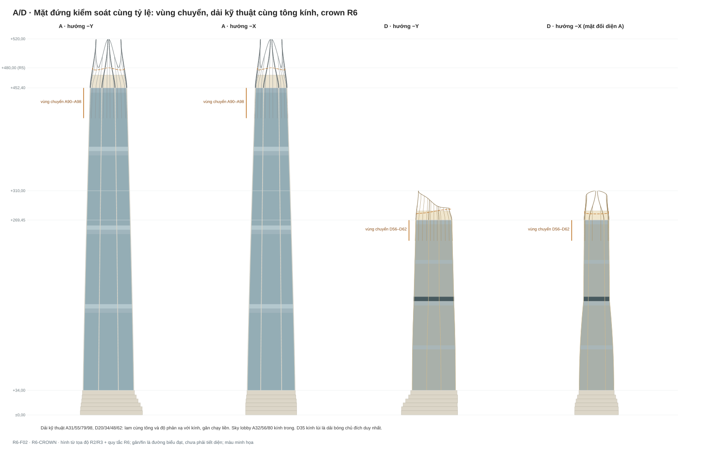

Ngoại quan M2 với vùng chuyển, dải kỹ thuật cùng tông kính và crown R6. Nét cam đứt là vành crown R5. Gân được biểu đạt bằng nét/đường dẫn, chưa là solid tiết diện hoặc cột chịu lực. Tầng kỹ thuật phải hòa nhịp mà vẫn có thông gió thật.

### B03b. Crown A "Hội lưu"

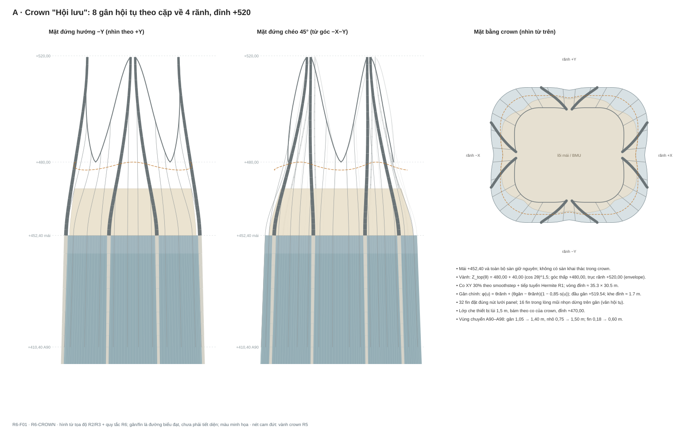

Mặt đứng −Y, mặt đứng chéo 45° và mặt bằng crown. Bốn mũi nhọn tại bốn trục rãnh; góc hạ về +480,00; lớp che thiết bị tới +470,00. Mặt bằng thể hiện đường gân hội tụ và vòng đỉnh R5 (nét đứt) để so độ co.

## 08. D: khung hình học, chuyển công năng và mặt dựng

B05: D07–D34 là gói văn phòng 70.000 m²; D35–D62 là gói khách sạn 50.000 m², kể cả tầng hỗ trợ/kỹ thuật. Hạt giống chân thân 60 ×48 m, R12. Tại D35 +157,45 m, hai profile gặp ở 56 ×36 m, R10. Biên mái tại +269,45 m (không đổi); crown R6 cao +286,00..310,00 m (R5: +278..285 m).

P04 (R6): tám gân cùng góc polar với A. D07–D55 giữ mặt 0,52 m, nhô 0,38 m (R3 thu dần về 0,36/0,25 m). Trong vùng chuyển D56–D62 (+240,85 → +269,45), gân tăng lên 0,80 m mặt và 0,80 m nhô; pier khách sạn nhô từ 0,30 lên 0,60 m. Lưới 112 cột panel thay ý tưởng 128 của R1. Chord 1,174–1,878 m. Gân nhỏ mặt 80 mm ở văn phòng và 50 mm ở khách sạn. Khách sạn gom 4 panel/pier thành 28 nhịp quanh chu vi, rộng 4,694–6,499 m; đây không phải 28 phòng/tầng.

B06/P05: D35 cao 6 m, kính lùi 3 m bằng offset polygon; giữ sàn biên và gân ngoài. Phần ngoài kính là vùng giao diện cần thiết kế, không mặc định thành diện tích sử dụng hoặc vườn không tải. Cột chính tiếp tục qua tầng này; không xóa cột để dựng một tầng mềm.

Crown D (C04, R6): Z_top = 286,00 + 24,00·((1 + cos(θ − 180°))/2)². Crown R5 cao ở phía +X, tức quay lưng lại A (A nằm ở hướng khoảng 196,6° nhìn từ D), nên A và D tạo thành một "máng" trên skyline. R6 đảo hướng: đỉnh +310 nằm ở mặt −X, đối diện A; phía xa thấp +286. XY co 15% theo smoothstep, tiếp tuyến Hermite giữ liền thân; vòng đỉnh khoảng 42,5 × 28,9 m.

Hai gân 157,5°/202,5° hội tụ về trục 180° thành một mũi nhọn duy nhất hướng về A, khe đỉnh khoảng 2,5 m, đầu gân +309,96 m. Sáu gân còn lại đi thẳng lên vành. 23 fin crown nằm đúng các pier khách sạn (mỗi 4 nút lưới), bỏ những pier trùng gân ±1 nút và pier giữa khe đỉnh. Nút bắt đầu nhịp pier (nút 0) cần nhóm facade xác nhận. Fin mặt 100 mm, nhô 0,60 → 0,90 m. Lớp che thiết bị lùi 1,20 m, đỉnh +282,00 m, tức 12,55 m trên mái; chiều cao máy cần xác nhận.

Chiều cao không khai thác (từ đỉnh D61 +263,65 m đến đỉnh) tăng từ 21,4 m (7,5%) lên 46,3 m (14,9%). Không thêm chóp đơn hoặc sàn phòng.

### B04b. Crown D hướng về A

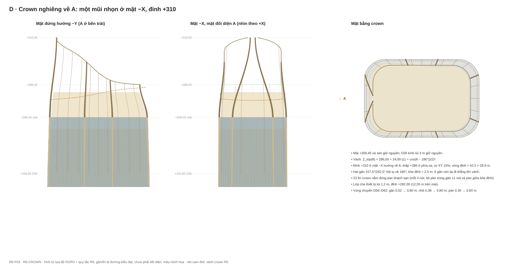

Mặt đứng −Y (A ở bên trái), mặt −X đối diện A và mặt bằng crown. Nét cam đứt là vành crown R5.

| Tầng / nhóm | Cốt m | Cao tầng m | Cần giữ |
| --- | --- | --- | --- |
| D01–D06 | 0 →27,60 | Như đế A | Đế tới +34,00 |
| D07 | 34,00 | 5,60 | Văn phòng |
| D08–19 / D21–33 | Theo CSV | 4,25 | Văn phòng |
| D20 / D34 | 90,60 /151,45 | 5,60 /6,00 | Kỹ thuật/lánh nạn giữ chỗ |
| D35 | 157,45 | 6,00 | Sky lobby khách sạn, kính lùi |
| D36–47 /D49–61 | Theo CSV | 3,80 | Khách sạn |
| D48 /D62 | 209,05 /263,65 | 5,20 /5,80 | Kỹ thuật, mái +269,45 |
| D56–D62 | 240,85 → 269,45 | Theo CSV | Vùng chuyển crown R6: gân/pier sâu dần, không đổi sàn |

### B04. Crown A/D: R5 và R6

| Chỉ số | A R5 | A R6 | D R5 | D R6 |
| --- | --- | --- | --- | --- |
| Mái / đỉnh kiến trúc, m | 452,40 / 480,00 | 452,40 / 519,54 | 269,45 / 285,00 | 269,45 / 309,96 |
| Chiều cao crown max, m (% chiều cao) | 27,6 (5,8%) | 67,1 (12,9%) | 15,6 (5,5%) | 40,5 (13,1%) |
| Vành thấp nhất, m | 477,00 | 480,00 | 278,00 | 286,00 |
| Vùng kết thúc đọc được, m (%) | 27,6 (5,8%) | 109,1 (21,0%) | 15,6 (5,5%) | 69,1 (22,3%) |
| Chiều cao không khai thác, m (%) | 34,4 (7,2%) | 73,9 (14,2%) | 21,4 (7,5%) | 46,3 (14,9%) |
| Co XY / vòng đỉnh, m | 12% / 44,4×38,3 | 30% / 35,3×30,5 | 3,5% / 48,3×32,8 | 15% / 42,5×28,9 |
| Gân chính kết thúc tại | +478,50 (giữa sóng) | 4 mũi, khe ~1,7 m | vành | 1 mũi về A, khe ~2,5 m |
| Fin crown / lệch mullion | 32 / tới 0,44 m | 32 / 0 | 16 / tới 0,56 m | 23 / 0 (trên pier) |

Bản vẽ crown R6: B03b (A) và B04b (D). Hình crown R3 (`AD_R3/F05-crowns.svg`) giữ để truy nguyên, không còn là cơ sở. Lớp che thiết bị, BMU, gió và đường bảo trì là điều kiện phải phối hợp tiếp.

## 09. B/C: footprint, cơ cấu duplex và cao độ

B07: mỗi tháp footprint 1.824 m² dạng hai cánh lệch, trong bounding box local 60 ×36 m. Tám đỉnh theo thứ tự: (0;0), (32;0), (32;6), (60;6), (60;36), (28;36), (28;30), (0;30). Đường bao này là cơ sở; không bo góc hoặc nắn mặt để làm đẹp khi chưa tính tác động.

Biến đổi B: X =94+u; Y =102+v. Biến đổi C: X =194−u; Y =53−v. C xoay toàn bộ nội dung căn hộ 180°, không dùng nguyên vị trí cửa B đặt vào C mà bỏ phép biến đổi. Giữ lõi, thang bộ, void và loggia nguồn.

Mỗi tháp 14 cặp điển hình ×6 căn +2 cặp penthouse ×4 căn =92 duplex; tổng hai tháp 184 căn. Cặp tầng thường cao 7,20 m =2×3,60 m. 7,20 m là nhịp hình học hai tầng, không phải chiều cao thông thủy phòng khách.

Quỹ thân trên đế 59.845,12 m²/tháp; trong đó sàn cư trú 54.373,12 m²/tháp. Đế 14.000 m²/tháp là budget cần phát triển. Không lấy 1.824×35 rồi bỏ qua lỗ thông tầng/cầu thang đã trừ.

| Tầng | Cốt đầu / cuối m | Cấu trúc sử dụng |
| --- | --- | --- |
| L01–05 | 0,00 →26,40 | Đế: cao 6 /5,4 /5,4 /4,8 /4,8 |
| L06 | 26,40 →30,60 | Clubhouse +lánh nạn +kỹ thuật, cao 4,2 |
| L07–22 | 30,60 →88,20 | 8 cặp duplex, 6 căn/cặp |
| L23 | 88,20 →92,40 | Lánh nạn/kỹ thuật, cao 4,2 |
| L24–35 | 92,40 →135,60 | 6 cặp duplex, 6 căn/cặp |
| L36–39 | 135,60 →150,00 | 2 cặp penthouse, 4 căn/cặp |
| L40 /crown | 150,00 →154,20 /159,90 (R6) | Kỹ thuật mái /khung crown mở, không thêm căn |

| Sàn một tầng | m² | Lưu ý |
| --- | --- | --- |
| Điển hình dưới /trên | 1.824 /1.576 | 248 m² lỗ void và cầu thang tầng trên |
| Penthouse dưới /trên | 1.824 /1.562,56 | 261,44 m² lỗ tầng trên |
| Common mỗi tầng | 488 | Gồm quỹ CORE, hai thang bộ và hall; chưa phải lõi kết cấu đã giải |

### B05. B/C: footprint, void và loggia

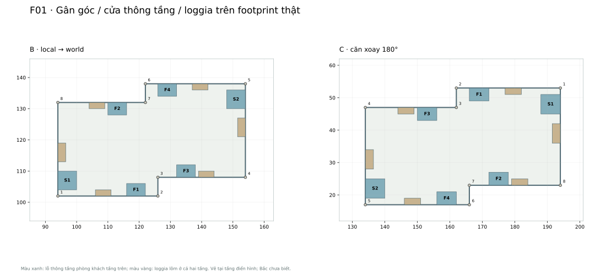

Phân căn là nguồn bố trí ngoại quan. Loggia phải có sàn ở cả hai tầng duplex. C dùng phép xoay180°. Các ô common không phải mặt bằng kết cấu hay thiết bị đã được xác nhận.

## 10. B/C: ngoại quan K2 và trải nghiệm trong căn

P06: khung mặt đứng theo cặp tầng duplex, gân đứng tiếp tục qua các tầng; loggia đặt trong chiều sâu biên nhà, không tạo ban công nhô và không đục lỗ ngẫu nhiên. Mỗi căn điển hình giữ đoạn 6 m frontage phòng khách tại vùng void và một loggia độc lập. Chỉ bỏ spandrel tại nơi nguồn thực sự không có sàn tầng giữa.

P07: tám gân góc neo tại tám đỉnh footprint; mặt 0,28 m, nhô 0,32 m. Có cả góc lõm; hướng tiết diện/neo ở góc lõm cần giải để không chặn miệng loggia hoặc nước thoát. Mullion mặt 55 mm, gân nhỏ nhô 180 mm. Lưới điển hình 124 đoạn panel quanh chu vi 192 m, chord thực 1,00–1,714 m.

Lưới R4 chia theo các mép cửa khách/loggia trước rồi chia phần còn lại. Loại vision không gắn owner trong JSON là vùng kính dự kiến, chưa xác định đó là cửa của phòng ngủ nào. Bên đánh giá cần packing phòng thật để quyết định cửa mở, mullion và vùng đặc; không tự coi tất cả mặt kính là khả dụng hoặc không có kết cấu sau kính.

B08: loggia ở cả hai tầng của mỗi duplex. F =5×2 m/tầng; S =6×2,5 m/tầng; P =10×2,4 m/tầng. Không xóa sàn loggia tầng trên để tạo một hốc cao 7,2 m trên hình. Tổng loggia điển hình 70 m²/tầng, penthouse 96 m²/tầng. Vách cạnh chọn lọc trong biên loggia giữ riêng tư; tránh trùm lam kín cả mặt căn.

Lan can nhìn xuyên là ý đồ kiến trúc; hệ kính an toàn, chiều cao, tải và cấu tạo phải được chọn theo điều kiện thực. Cửa mở/ventilation cần phối hợp gió cao tầng và vận hành. Kỹ thuật điều hòa, cấp/thoát gió, nước mưa và rèm phải có chỗ trong nhịp, không phát sinh dàn nóng hoặc các mảng sửa chữa lộ ngoài.

| Hạng căn | Gross duplex riêng m² | Loggia hai tầng m² | Số cả B/C |
| --- | --- | --- | --- |
| F-L /F-S | 355,68 /307,68 | 20 /20 | 56 /56 |
| S | 548,64 | 30 | 56 |
| P-L /P-S | 606,64 /598,64 | 48 /48 | 8 /8 |

### B06. B/C: mặt đứng từ sàn thực

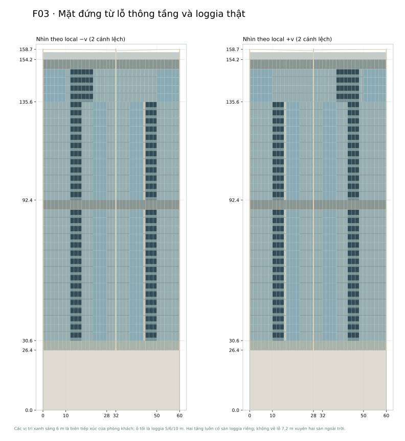

Nhịp7,2 m đi theo lịch cặp tầng; vùng kỹ thuật giữ cao tầng riêng. Không biến mọi loggia thành hốc cao hai tầng hoặc phủ spandrel vào void khách không có sàn.

## 11. B/C: crown, kỹ thuật và giới hạn tầm nhìn

P08 (C07, R6): mái +154,20 m; crown tới +159,90 m, không có tầng khai thác mới. B/C là tháp căn hộ nên vẫn giữ đầu bài H02 (tối đa 40 tầng, 160 m). Chủ đầu tư chỉ nới giới hạn chiều cao cho A/D. Trong H02 chỉ còn 1,3 m dư, nên crown B/C không được làm bằng chiều cao mà bằng một vùng kết thúc có chiều sâu:

- Khung mở +154,20 → +159,90 m thay dải crown đặc của R4: fin 55 mm, sâu 0,45 m tại mọi mullion lưới điển hình (124/tháp); dầm đỉnh +159,30..159,90; không còn mảng đặc, thiết bị được che bằng hàng lam bên trong trên mái L40.
- Tám gân góc cùng kết thúc ở +159,90 m. R6 bỏ chênh 0,6 m giữa các góc của R4 (158,1..158,7), vì ở khoảng cách thường mức chênh này đọc như sai số.
- Vùng kết thúc L36 → đỉnh (+135,60 → +159,90, tức 24,3 m, 15% chiều cao): từ L36 gân góc tăng mặt từ 0,28 lên 0,40 m và nhô từ 0,32 lên 0,60 m; mỗi loggia penthouse 10 × 2,4 m có khung viền sâu 0,45 m ôm trọn hai tầng duplex. Loggia vẫn có sàn ở cả hai tầng.
- L06, L23, L40 dùng lam cùng tông kính (C06), nên L40 đọc như chân của khung crown chứ không thành "mũ" tối.

Nếu chủ đầu tư nới cả H02, có thể nghiên cứu thêm một crown B/C cao hơn. Phương án đó không nằm trong R6 vì đổi đầu bài căn hộ.

L06, L23, L40 chứa chức năng kỹ thuật/lánh nạn giữ chỗ. Lam kỹ thuật cần diện tích free area và đường gió thật, vẫn hòa cùng nhịp mặt đứng. Crown che thiết bị nhưng không được làm nghẹt gió, mất lối BMU hay tạo thêm chiều cao vượt H02. Khung fin mở có thể cản cần BMU, nên cần cân nhắc khoang fin tháo được hoặc davit gắn dầm đỉnh. Đế B/C riêng tư, portal theo sàn thật; không vẽ sảnh hai tầng rồi giữ nguyên sàn tầng hai.

### B06b. B/C: vùng kết thúc và crown R6

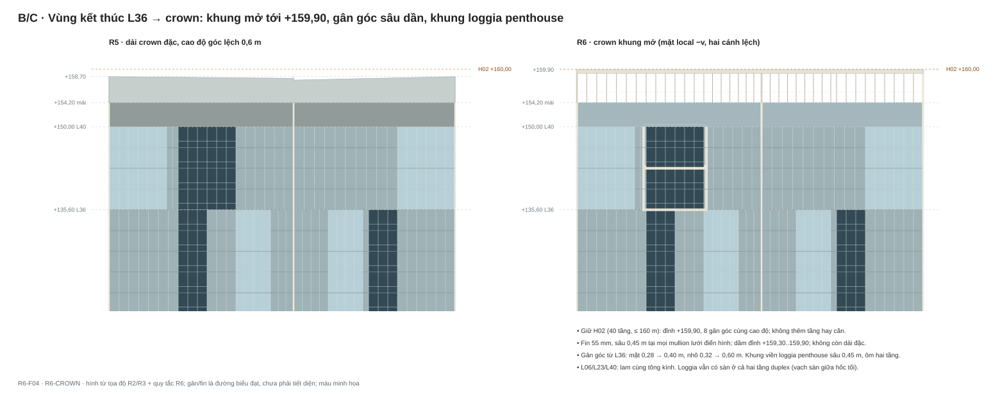

Mặt local −v (hai cánh lệch), R4/R5 bên trái và R6 bên phải. Loggia tối, frontage phòng khách sáng; vạch sàn giữa hốc loggia thể hiện sàn ở cả hai tầng.

Kiểm tra hình học ngang: mắt cách kính 1,5 m, cửa khách 6 m cho góc nominal 118,8° trước vật chắn. Miệng loggia F/S/P cho khoảng 71,1° /73,7° /104,1°. Kết quả cho thấy loggia sâu cần đi cùng cửa khách độc lập rộng; không chứng minh mọi căn có view toàn cảnh.

Tại +75,35 m, mô hình lấy 241 tia đều trong góc cửa và giao silhouette các tháp. Có che khuất đáng kể ở F1 của B và C. Đây là phân tích một cao độ/mặt bằng, chưa bao gồm cảnh quan xa, trần, dầm, rèm, kính, hướng nhìn đứng hoặc riêng tư qua kính. Số tia không tương đương phần trăm giá trị view hoặc diện tích cửa bị che.

| Cửa | Tia bị chắn theo tháp | Tổng union /241 | Khoảng nhìn trống chính, ° so normal |
| --- | --- | --- | --- |
| B/F1 | A74; C94 | 168 | −22,8..+9,4 |
| B/S1 | A76 | 76 | −59,4..+21,8 |
| C/F1 | B94; D59 | 153 | −30,2..+9,4 |
| C/S1 | D68 | 68 | −59,4..+25,7 |

### B07. B/C: mặt cắt loggia

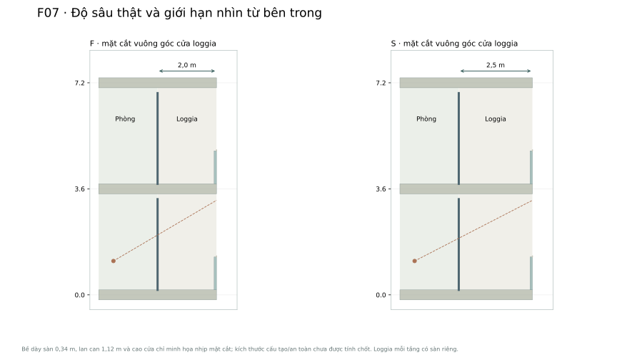

Độ sâu F2 m và S2,5 m; hình cắt thể hiện cả hai sàn loggia. Guard và mép sàn là minh họa chưa duyệt cấu tạo. Cần phối hợp thoát nước, cửa, tải và neo.

### B08. B/C: kiểm tra hướng nhìn

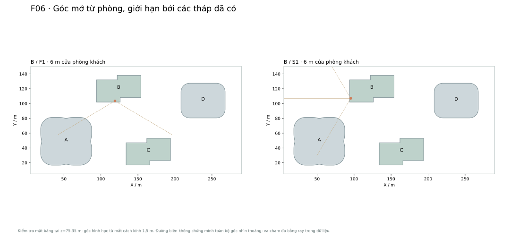

241 tia tại +75,35 m theo silhouette. Tia bị chắn là tín hiệu thiết kế cần xử lý, không là tỷ lệ giá trị view. Cần đánh giá nhiều cao độ và từ phòng thật.

## 12. Khối đế, quảng trường và mall: giao diện ngoại quan

B09: đế A/D có sáu tầng, kết thúc +34 m; footprint tầng một 5.800 /4.500 m². Sàn sau trừ lỗ A01 =5.500 m², D01 =4.400 m²; số này khác diện tích chiếm đất. Quỹ đế A28.000 /D22.000 m², trong đó mall A21.000 /D17.000 và riêng/phụ trợ A7.000 /D5.000 m².

Ngoại quan chân A/D dùng đá/khoáng sáng ấm, kính rõ và nhịp đứng mục tiêu khoảng 3 m hướng quảng trường. Portal sảnh riêng phải nằm ở vị trí phục vụ đúng lõi/luồng; không tự mở mặt đế cao hai tầng bằng cách xóa sàn. Gân thân kết thúc có kiểm soát ở +34 m, không kéo cả tám gân thành cột trang trí xuyên mall.

A tách sảnh văn phòng khỏi mall; D tách văn phòng/khách sạn/BOH. B/C có tiếp cận cư dân độc lập và kiểm soát. Hai đế A/D không nhập thành một đế chung trên mặt đất và không có cầu nối trên cao; sự liên thông thương mại nằm ở B1.

B10: mall B1 =14.000 m² polygon liên thông, tổng mall gross 52.000 m². R2 mở tham số băng nối lên 44,36 m để bù 824 m² quỹ lõi tăng; tham số này không phải bề rộng hành lang thông thủy. Quảng trường mặt đất vẫn theo băng 24 m. Mall không chạm buffer 6 m/đế B/C và quỹ ram.

Atrium, mái lấy sáng, lan can hố mở, thang cuốn và đầu thoát khí tại quảng trường chưa được chốt. Nếu đề xuất, phải đặt polygon/cao độ, cập nhật GFA/mật độ và kiểm tra chống ngập, khói, giao thông, gió, tải quảng trường. Không tự khoét quảng trường chỉ để làm đẹp ảnh.

| Đế | Footprint m² | Budget m² | Trạng thái |
| --- | --- | --- | --- |
| A /D | 5.800 /4.500 | 28.000 /22.000 | Sàn từng tầng có polygon; chia retail/sảnh là budget |
| B /C | 3.456 /3.600 | 14.000 mỗi tháp | Đế riêng, chi tiết mặt bằng/công năng còn mở |
| Mall B1 | 14.000 | 14.000 | Polygon gross, chưa chia shop/NLA |

### B09. Mall B1 và các lõi R2

Mall14.000 m² gross liên thông A/D; tránh B/C và ram. Băng tạo hình44,36 m không phải hành lang thông thủy. Chưa chia shop, BOH hoặc diện tích thuê.

## 13. Hầm chung và tải tiếp đất

B11: envelope hầm X10..285, Y10..145 =275×135 m =37.125 m²/tầng; năm tầng tổng 185.625 m². Khoảng lùi 10 m là giả định chưa kiểm chứng địa điểm. B1 tại−6 m chứa mall 14.000, còn 23.125 m² cho xe/kỹ thuật/lõi/giao thông. B2–B5 chỉ xe/kỹ thuật.

Sau mall còn 171.625 m² quỹ hầm, chưa phải diện tích đỗ xe hữu dụng. Chưa chốt số xe. Cần lưới cột, đài/cột lớn, lõi thang, ram thật, phòng máy/bể, đường xe, phân khoang và tuyến cư dân/retail trước khi chia ô.

Hai quỹ ram 18×60 m: R1 X12..30,Y84..144; R2 X263..281,Y11..71. Đây là vùng giữ chỗ, không phải ram đã giải dốc/bán kính. Quỹ loading: X22..42,Y15..27 và X253..270,Y119..131. Các mép tiếp cận chưa gắn đường công cộng nên không khóa cửa xe chỉ từ hình này.

Các lõi/cột phải truyền lực qua đế xuống hầm. Không đặt ram, atrium hoặc anchor tenant vào vùng tải lớn rồi giả định chuyển tải miễn phí. Nếu cần transfer, phải ghi tầng, nhịp, quỹ chiều cao, tải và ảnh hưởng retail/MEP trước khi đổi ngoại quan.

Móng chưa chọn. Cần khảo sát địa chất, nước ngầm, đào sâu, lún chênh bốn tháp và tương tác hầm. Khe nhiệt/lún, chống thấm và thoát nước quảng trường chưa định vị. Cốt B5 là sàn, không phải đáy đào.

| Hầm | Cốt sàn m | Cao tầng m | Chức năng |
| --- | --- | --- | --- |
| B1 | −6,00 | 6,00 | Mall A/D +xe/kỹ thuật còn lại |
| B2 | −9,60 | 3,60 | Xe/kỹ thuật |
| B3 | −13,20 | 3,60 | Xe/kỹ thuật |
| B4 | −16,80 | 3,60 | Xe/kỹ thuật |
| B5 | −20,40 | 3,60 | Xe/kỹ thuật |

## 14. Khung chịu lực: ý đồ và điểm phải phối hợp

O01: nghiên cứu A theo lõi trung tâm +cột lớn biên +cột phụ tải đứng và các tầng liên kết cứng. Tám gân facade gợi hướng tổ chức, nhưng tâm cột dự kiến phải lùi vào trong và được chọn lại với lưới thực. Không đồng nhất vỏ gân nhôm với megacolumn; không có chứng minh hệ tám cột đủ chịu lực.

Đường tải đứng: sàn →hệ sàn/dầm →cột/lõi →đài/móng. Đường tải ngang: mặt dựng chịu gió →neo/sàn diaphragm →lõi và hệ biên →liên kết cứng →móng. Neo facade phải cho phép drift và co ngắn chênh; không tạo thanh nhôm chịu tải ngoài ý đồ.

A31–32/A55–56/A79–80 là quỹ phối hợp outrigger/belt, kỹ thuật và sky lobby. Mặt ngoài giữ đường gân liên tục, nhưng nội bộ phải phân vùng kết cấu, khí, phòng máy và lối người. Vành sàn thấp có nhịp lớn; không tự coi toàn bộ khoảng lõi–biên là sàn phẳng không cột.

D theo lõi +cột biên +sàn, vùng D34–35 phối hợp chuyển chương trình/kỹ thuật. Cột chính không bị xóa ở kính lùi. Không mặc định D dùng outrigger giống A; quyết định cần phân tích tải ngang, độ cứng và tiện nghi.

B/C hiện có footprint, các ô common và phân căn nhưng chưa có lưới cột/tường chịu lực được giải. Cần đưa cột/vách thật vào căn và tầng hầm; tránh void khách, loggia và cầu thang duplex. Không suy từ CORE16×20 m thành tường lõi hoặc số thang đã xác nhận.

Crown R6 là khung thép kiến trúc cao 67,1 m ở A và 40,5 m ở D, đặt trên mái. Các lưỡi gân hội tụ là console tự do, phải neo về hệ lõi/cột qua tầng A98/D62; tải gió lên lưới fin mở, dao động (vortex shedding, flutter fin), tiếng hú qua khe đỉnh và ảnh hưởng tới gia tốc tầng trên đều phải thử hầm gió. Khoang crown có thể là vị trí đặt bộ giảm chấn khối lượng nếu phân tích động yêu cầu; đây là cơ hội phối hợp, không phải giả định đã chọn.

Chưa có tiết diện chịu lực, tải thiết bị, gia tốc gió, phân tích động đất hoặc móng. Đơn vị đánh giá cần nêu mức độ khả thi và phạm vi kiểm tra tiếp, không xác nhận an toàn kết cấu chỉ từ bộ hình học.

### B10. Envelope và quỹ lõi

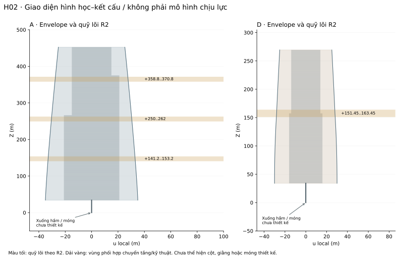

Sơ đồ mặt chiếu u–Z của biên thực và quỹ lõi. Chưa vẽ hệ cột/giằng. Dải chuyển tầng giữ chỗ cho phối hợp, không chứng minh một hệ chịu lực đã đạt yêu cầu.

## 15. Lõi R2: không gian mà kiến trúc phải dành và giới hạn

B12/O02: R2 đưa vùng lõi giữ chỗ R1 thành module giếng thử. Vỏ/GFA giữ nguyên, diện tích sử dụng giảm. Lõi bao gồm tường, giếng, sảnh/circulation, MEP và phần phụ trợ; module ngoài tường không phải clear shaft của nhà cung cấp.

A có 37 giếng ở đế =15 local+18 shuttle+4 phục vụ. Toàn tháp cấu hình thử 77 bộ thang do các local độc lập xếp nối theo chiều cao; không có 77 giếng xuyên suốt. D cấu hình thử 23 bộ. Các số này chưa gồm thang mall/xe/B/C và không phải danh mục đặt mua.

Lõi A thu ở A34/A58/A82 sau quỹ đầu giếng express. Khách vùng cao đổi từ shuttle sang local tại A32/A56/A80. D có thang khách sạn đi trực tiếp từ sảnh dưới lên khách sạn, tách BOH. Cấu hình phải được mô phỏng lại khi thay dân số hoặc packing.

Điểm nghẽn: hai nhóm thấp A có dự phòng công suất chỉ khoảng 1–2% trong mô hình cơ sở. Tăng lõi làm proxy net văn phòng A giảm 28.080 m² và D giảm 9.360 m² so R1. Không khóa diện tích lõi như kích thước tối thiểu hoặc tối ưu.

R2 thử pit 2 m và overhead 5,5 m; còn 2,9 m trước khi giải slab/dầm/máy thật ở cụm liên kết local. PCCC, số/bề rộng thang bộ, sảnh bảo vệ, giếng chữa cháy và lánh nạn chưa xác nhận. Cần kiểm tra thiết bị và vận hành trước khi khóa nội thất hoặc cửa đế.

| Vùng | Bounds local u;v m | Quỹ m² |
| --- | --- | --- |
| A01–33 | −21..21; −18..18 | 1.512 |
| A34–57 | −21..21; −18..14 | 1.344 |
| A58–81 | −15..21; −14..14 | 1.008 |
| A82–98 | −15..15; −13..13 | 780 |
| D01–34 | −16..16; −16..16 | 1.024 |
| D35–62 | −14..14; −10..10 | 560 |

## 16. Kiểm tra kính và khả năng chế tạo

P09/O03: chiến lược kính phẳng low-E màu trung tính, chưa chọn sản phẩm/coating, độ dày, U-value, SHGC, phản xạ hoặc truyền sáng. A/D panel hóa bằng các vòng chia nhịp cùng index; ô danh nghĩa một tầng chưa phải số IGU mua.

R3 kiểm tra độ vênh quad giữa các vòng so mặt phẳng best-fit. Ngưỡng 3 mm là sàng lọc nghiên cứu, không phải dung sai chế tạo. A thuận lợi hơn; D có 772 ô vượt ngưỡng, tập trung D15–D34. Không nhận một quad vênh làm IGU phẳng và không mặc định uốn nguội.

R3 đề xuất mặt phẳng kính fit cục bộ và jamb/spandrel/adapter theo dải tầng D15–D34. Độ lệch góc tới mặt phẳng tối đa 22,70 mm; khoảng cách góc giữa hai ô sau fit tối đa 41,73 mm trong phép kiểm tra. Đây là hai chỉ số khác nhau. Không chỉ dự trù một adapter 23 mm rồi kết luận xử lý kín được mọi khe.

D35 kính lùi cần bộ panel riêng. Crown, gân, vùng mở và đế chưa nằm trong thống kê kính thân danh nghĩa. Vùng chuyển R6 A90–A98 thêm một họ panel frit tăng dần (16 cột panel quanh 8 gân) và bracket fin sâu 0,18 → 0,60 m tại 32 nút. D56–D62 thêm bracket pier sâu 0,30 → 0,60 m. Cả hai cần mock-up riêng. Crown R6 không có kính; lớp che thiết bị là lam kim loại. Diện tích bề mặt nominal A88.313,94 /D40.905,01 m² chỉ là chỉ số mặt lưới nghiên cứu, không phải diện tích kính đặt hàng.

B/C có mặt phẳng đứng nhưng cửa duplex/void, mép sàn loggia, vách căn và góc lõm tạo các điểm neo/chống cháy/kín nước riêng. Thử nghiệm mock-up cần cửa khách hai tầng, loggia có hai sàn, góc gân, lam kỹ thuật và vùng crown; kiểm tra tầm nhìn từ bên trong cùng với biểu đạt ngoài.

| Chỉ số nghiên cứu | A | D |
| --- | --- | --- |
| Ô quad danh nghĩa | 14.720 | 6.272 |
| Vênh max /P95, mm | 1,16 /0,65 | 22,70 /7,03 |
| Ô vượt 3 mm | 0 | 772 (12,31%) |
| Gap góc sau planar fit max, mm | 2,28 | 41,73 |

### B11. Ô mặt dựng và các giao diện

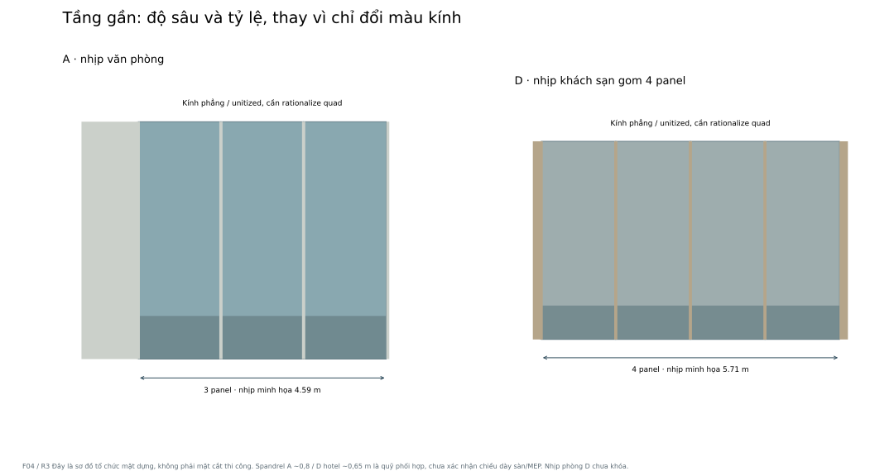

Cửa/nhịp/đặc–rỗng theo công năng. Không dùng ô quad danh nghĩa làm thông số IGU phẳng. D15–D34 phải giải planar fit, adapter và khe; D35 có bộ riêng.

## 17. Vật liệu, chiếu sáng và các giao diện mặt dựng

P10: kính trung tính, kim loại bạc ấm satin, khoáng/đá sáng ở đế và các mép đặc có chủ đích. A sắc và mạnh hơn; D champagne nhạt tập trung nhịp khách sạn/crown; B/C bạc ấm và khoáng sáng với nhấn champagne tiết chế ở hốc sảnh. Màu trong hình/MTL chỉ là swatch, chưa phải mẫu vật liệu thực.

P11 (C05, R6): chiếu sáng kín, chọn lọc; crown là một "đèn lồng" nhiều lớp. Concept A 3500 K, D 3000 K, B/C 3000 K. Thứ bậc độ sáng tương đối là 1 : 0,6 : 0,3; đây là tỷ lệ ý đồ, chưa phải cd/m².

- Lớp 1: lớp che thiết bị được hắt sáng đều để fin ngoài đọc thành bóng.
- Lớp 2: gân chính được chiếu sượt (grazing), sáng dần qua vùng chuyển A90–A98 / D56–D62.
- Lớp 3: bốn khe đỉnh A và khe đỉnh D là điểm sáng nhất.
- Sky lobby A32/56/80 sáng từ trong. B/C chỉ chiếu mặt trong khung crown và sảnh.

Không dùng dải LED toàn thân, viền từng tầng hoặc màn media phủ tháp. Đèn tích hợp trong gân phải hướng ra ngoài để tránh chói vào văn phòng A90–A97 và phòng khách sạn D56–D61.

Đánh giá ngày và đêm bằng cùng mô hình, cùng camera và exposure để so. Cần mẫu kính/nhôm/đá, mẫu đèn và kiểm tra chói tới phòng khách sạn/căn hộ. Chưa có phương vị nên chưa khóa che nắng hoặc định lượng hiệu suất năng lượng.

| Giao diện | Ngoại quan cần giữ | Nghiên cứu bắt buộc trước khi triển khai |
| --- | --- | --- |
| Slab/neo | Nhịp đứng và aperture khách | Drift, co ngắn, võng, dung sai và anchor |
| MEP/lam | Màu/nhịp đồng bộ, không dàn nóng lộ | Free area, áp suất, cấp/thoát gió, đường bảo trì |
| Loggia | Sàn cả hai tầng, guard nhìn xuyên | Dốc sàn, nước tràn, khe cửa, neo guard, tải |
| PCCC | Void và vùng kỹ thuật theo sàn thật | Chống cháy mép sàn, khoang/cavity, vật liệu, thoát nạn |
| BMU/crown | Thiết bị ẩn trong envelope; crown mở không bị cắt để nhường máy | Monorail/gondola trong khoang crown A/D, tiếp cận dây cho lưỡi gân, khoang fin tháo được ở B/C; tải, điểm neo, cửa tiếp cận |
| Khung crown R6 | 4 mũi A, 1 mũi D, khung mở B/C | Thép khung, console lưỡi gân, neo về A98/D62, hầm gió, tiếng hú qua khe, tĩnh không hàng không |
| Gân/góc lõm | Gân liên tục có phân cấp | Tải gió, support, thoát nước, tránh bẫy rác |
| Đế/quảng trường | Lối sảnh rõ, tuyến cư dân riêng | Tiếp cận, chống ngập, thông gió hầm, smoke outlet |

### B12. Biểu đạt ban ngày /ban đêm (R6)

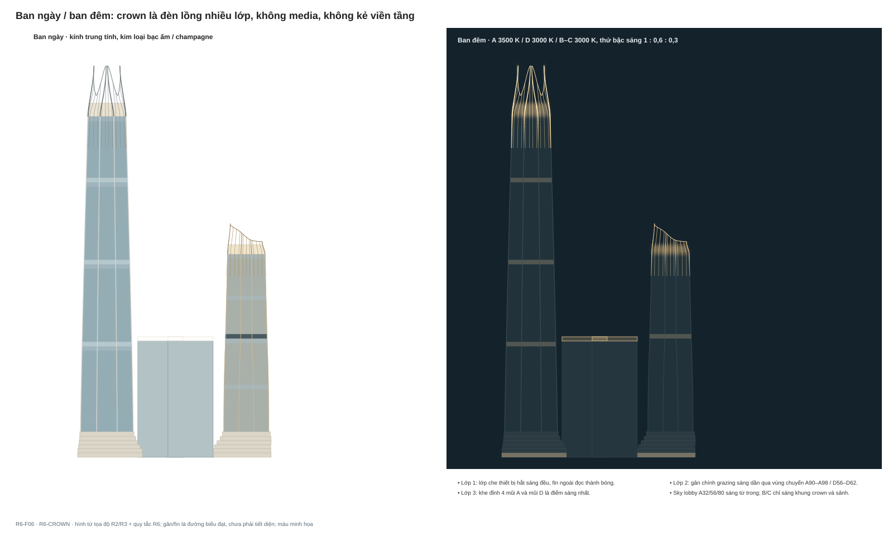

Màu và độ sáng chỉ là minh họa. Crown là đèn lồng nhiều lớp; khe đỉnh sáng nhất; không suy ra nhiệt màu mẫu, luminance hoặc mức chói từ hình.

## 18. Ma trận ràng buộc dùng khi đề xuất thay đổi

Các mã dưới đây cho phép bên nhận phản biện mà không phải đoán thông số nào được giữ. Trạng thái B/P là cơ sở của phương án tham chiếu để so sánh, không ngăn đề nghị cải thiện; thay đổi phải có sơ đồ và số liệu tác động. Đầu bài H cần chủ đầu tư quyết định nếu muốn thay.

| Mã | Trạng thái | Nội dung phải kiểm soát | Thay đổi phải báo |
| --- | --- | --- | --- |
| H01–04 | H | Đất/FAR/mật độ; limit căn hộ; mixed use; B1 mall A/D và riêng tư B/C | Giới hạn, công năng, luồng người |
| B01–02 | B | Ngân sách 631.690,24; mật độ 38,83%; dự phòng FAR/mật độ | Diện tích từng gói và giả định FAR |
| B03–06 | B | A/D center, loft, sàn, cao độ tầng, mái; kính D35 lùi 3 m. Crown/đỉnh theo R6: A envelope +520, D +310 (quyết định chủ đầu tư) | Silhouette, sàn, drift/MEP, keys, tĩnh không |
| B07–08 | B | B/C 92 duplex/tháp; footprint; void; loggia cả hai tầng | Số căn, gross/net, view, lịch tầng |
| B09–11 | B | Đế riêng; quảng trường; mall gross; hầm 5 tầng | Sảnh/retail, lỗ mở, ram, kỹ thuật |
| B12 | B/O | Quỹ lõi R2 và cấu hình thang thử | Giếng, diện tích sử dụng, RTT/HC, kết cấu |
| P01–05 | P | A/D 8 gân, 160/112 panel; gân không thu mảnh dần (R6); vùng chuyển A90–A98/D56–D62; crown A 8 gân hội tụ + 32 fin, D 1 mũi + 23 fin trên pier | Tỷ lệ gân, lưới, chế tạo, giá, kính nhìn ra vùng chuyển |
| P06–08 | P | B/C nhịp 7,2 m; 8 gân; 124 panel; crown khung mở +159,90; vùng kết thúc L36 → đỉnh | Aperture, loggia, tầm nhìn, phòng, H02 |
| P09–11 | P/O | Kính phẳng, palette, lam kỹ thuật cùng tông kính, chiếu sáng đèn lồng 1 : 0,6 : 0,3 | Fit, khe, năng lượng, chói, BMU |
| O01–03 | O | Hệ chịu lực, lõi tối ưu, cấu tạo panel; khung thép crown R6, hầm gió, BMU crown, tĩnh không | Giả định, kiểm chứng và đầu ra chuyên ngành |

## 19. Các vấn đề cần bên đánh giá trả lời

Đề nghị trả lời theo nhóm dưới đây, nêu bằng chứng từ tọa độ/mặt bằng và mức chắc chắn. Không chỉ đưa ảnh khác đẹp hơn; cần chỉ ra vì sao thay đổi giải được vấn đề và phải hy sinh gì.

| Ưu tiên | Câu hỏi | Đầu ra mong đợi |
| --- | --- | --- |
| 1 | M2/K2 có đạt gia đình bốn tháp, hierarchy và đẹp cả trong–ngoài? | Nhận xét skyline, quảng trường và POV căn; sơ đồ trước/sau |
| 1 | A thấp có thể tối ưu lõi/thang mà giữ diện tích sử dụng và mức dịch vụ? | So cấu hình vận hành, số giếng, net, lúc một xe ngừng |
| 1 | Có hệ chịu lực khả thi trong envelope, vùng kỹ thuật và hầm? | Lưới/đường tải định hướng, vị trí xung đột/transfer |
| 1 | Kính D15–D34 có thể planarize và kín nước với nhịp hiện tại? | Chi tiết adapter/khe, dung sai, mock-up và giải pháp khác |
| 2 | D packing khách sạn cao cấp có phù hợp 28 macro bay? | Mặt bằng phòng/BOH; keys thật thay tải thử 360 |
| 2 | B/C có giữ phòng ngủ, view và riêng tư với lưới facade? | Mặt bằng phòng, vị trí mở kính; view nhiều cao độ |
| 2 | Đế/mall/hầm có chứa đủ lõi, xe, kỹ thuật và tuyến riêng? | Polygon công năng, sảnh, ram, tải và B1 hoàn chỉnh |
| 1 | Crown R6 (A +520, D +310) có khả thi về khung thép, gió, tĩnh không và quy hoạch? | Sơ bộ thép lưỡi gân và neo A98/D62; hầm gió; xác nhận tĩnh không khi có địa điểm; phương án lùi nếu bị giới hạn chiều cao |
| 2 | Vùng chuyển A90–A98/D56–D62 có giữ chất lượng văn phòng/phòng khách sạn? | Tầm nhìn qua fin 0,6 m và frit 0–50%, chói từ đèn gân, mock-up |
| 3 | Có thể vận hành facade/crown và đạt palette/ánh sáng? | BMU/monorail trong crown, gió/nắng/chói, mẫu vật liệu, chiến lược thi công/chi phí |

## 20. Yêu cầu sản phẩm đánh giá và tiêu chí đối chiếu

Bản đánh giá cơ sở cần dùng đúng bốn vị trí, lịch tầng, đường bao và budget hiện tại. Nếu đề nghị phương án thay, xuất riêng và gắn mã thay đổi. Hình renders phải dựng từ model đối chiếu tọa độ; ảnh concept/GenAI phải ghi là minh họa và không thay bản vẽ kiểm soát.

Bộ tối thiểu đề nghị trả: báo cáo vấn đề; tổng mặt bằng; mặt đứng cùng tỷ lệ; mặt cắt qua tầng chuyển/crown và một duplex; mặt bằng packing đại diện; ma trận giao diện; danh sách thay đổi và tác động diện tích; kết luận có thể phát triển /cần sửa /chưa đủ dữ liệu cho từng vấn đề.

Model trao đổi đề nghị đơn vị mét, Z-up, tọa độ site; tách envelope, slab/void, core, facade major/minor, loggia, crown, podium, basement. B/C phải có hai tầng loggia và lỗ tầng trên thật. Mọi floor ID theo A01/D35/B07…; không dùng số tầng marketing thay số tầng vật lý.

Dung sai đối chiếu nghiên cứu: tọa độ/cao độ 0,01 m; chênh tổng diện tích dưới 0,10 m² khi dùng đúng polygon nguồn. Đây là mục tiêu QA dữ liệu, không phải dung sai chế tạo hoặc thi công. Nếu dùng NURBS hoặc thay thuật toán thì nêu chênh thay vì cố ghi khớp.

Các thông số chưa có phải ghi O; không tự thêm định mức pháp lý, số ô xe, tải, tiết diện hoặc keys vào kết luận. Các kiểm tra chuyên ngành có thể triển khai theo giai đoạn, nhưng cần nêu thứ tự phụ thuộc trước khi chủ đầu tư khóa ngoại quan.

| Mỗi kiến nghị thay đổi phải có | Nội dung |
| --- | --- |
| Nhận diện | ID, nguồn/tầng/zone, rule bị tác động, mức ưu tiên |
| Trước /sau | Hình học, số lượng, diện tích, GFA/mật độ, view/công năng |
| Lý do | Chứng cứ: tọa độ, bản vẽ, tính toán hoặc phép thử |
| Hệ quả | Kết cấu, MEP, PCCC, BMU, vận hành, chi phí và lịch |
| Trạng thái | Đề xuất /cần dữ liệu /chờ quyết định; người chịu trách nhiệm |

## 21. Điểm mở, nguồn tham chiếu và danh mục bàn giao

Thiếu dữ liệu đầu vào: địa điểm/phương vị, quy hoạch chi tiết, khảo sát đất/nước, đấu nối giao thông/hạ tầng, chỉ tiêu kinh doanh và mức dịch vụ. Các giới hạn người dùng được dùng làm đầu bài nghiên cứu; bộ này không xác nhận chúng là quy chuẩn áp dụng cho ô đất.

Nguồn SOM đã dùng trong R3/R4: Tianjin CTF (phương pháp vỏ và mullion/crown); Beijing Greenland (đối chứng lăng trụ); Hangzhou Century Center (ánh sáng theo nhịp); 35 Hudson Yards (phân cấp vật liệu); The Park Loggia và New Taipei City residential towers (loggia/chiều sâu/đường đứng). Chỉ ghi bài học, không chuyển hiệu suất hoặc thẩm quyền thiết kế sang HỘI LƯU.

Hồ sơ nguồn được đóng băng tại thời điểm bàn giao 30/09/2026. File manifest ghi SHA-256 từng file để kiểm tra nguyên vẹn. R5 không đổi hình học R2 hoặc dữ liệu duplex. R6-CROWN chỉ thêm crown/đỉnh/mặt dựng cận đỉnh; mọi file nguồn R1–R4 giữ nguyên byte, R6 nằm trong các file mới liệt kê dưới đây. Mục tiêu là tạo cùng một nền đánh giá, không biến phần còn mở thành quyết định đã chốt.

Điểm mở riêng của R6: khung thép crown và neo; hầm gió; BMU/monorail trong crown; tĩnh không hàng không và quy hoạch cho +520/+310 (chưa có địa điểm); chiều cao thiết bị dưới lớp che +470/+282; chói tới A90–A97 và phòng D56–D61; chi phí, tiến độ; xác nhận nút bắt đầu nhịp pier D.

| Đường dẫn trong ZIP | Dùng để |
| --- | --- |
| 00_DOC_TRUOC.md | Điểm vào, trạng thái, thứ tự ưu tiên và cảnh báo model cũ |
| 01_HO_SO/HOI_LUU_R5_HO_SO_BAN_GIAO.pdf +.md | Hồ sơ tổng hợp tự đọc, vision và constraints |
| 02_NGOAI_QUAN/AD_R3.html; BC_R4.html | Hai hồ sơ minh họa độc lập R3/R4, dữ liệu/mã nhúng (lịch sử cho phần crown) |
| 02_NGOAI_QUAN/CROWN_R6.html | Hồ sơ crown R6 tự chứa: 7 bản vẽ, bảng R5/R6, JSON nhúng |
| 02_NGOAI_QUAN/drawings/ | SVG gốc R3/R4, bản vẽ bàn giao và `CROWN_R6/R6-F01…F07` |
| 02_NGOAI_QUAN/scripts/ | `build_crown_r6.py` và module R6, chỉ dùng thư viện chuẩn Python |
| 03_DU_LIEU_KIEM_SOAT/ | JSON/CSV biên sàn, schedule, lưới facade, loggia/void; `facade-crown-r6.json`, `crown-R6-AD-surface.csv`, `crown-R6-AD-members.csv` |
| 04_NGUON_HINH_HOC_LOI_R2/ | Gói R2 nguyên trạng; source-r 1 là lịch sử tham chiếu |
| 05_DANH_GIA/ | Ma trận ràng buộc và biểu mẫu phản biện/thay đổi |
| MANIFEST_SHA256.json | Danh mục file, kích thước và hash |

## Nguồn tham chiếu chính thức

- [SOM /Tianjin CTF](https://www.som.com/story/reinventing-the-skyscraper/)
- [SOM /Beijing Greenland Center](https://www.som.com/projects/beijing-greenland-center/)
- [SOM /Hangzhou Century Center](https://www.som.com/projects/greenland-hangzhou-century-center/)
- [SOM /35 Hudson Yards](https://www.som.com/projects/35-hudson-yards/)
- [SOM /The Park Loggia](https://www.som.com/projects/the-park-loggia-at-15-west-61st-street/)
- [SOM /New Taipei residential towers](https://www.som.com/news/taipei-city-design-reveal/)
