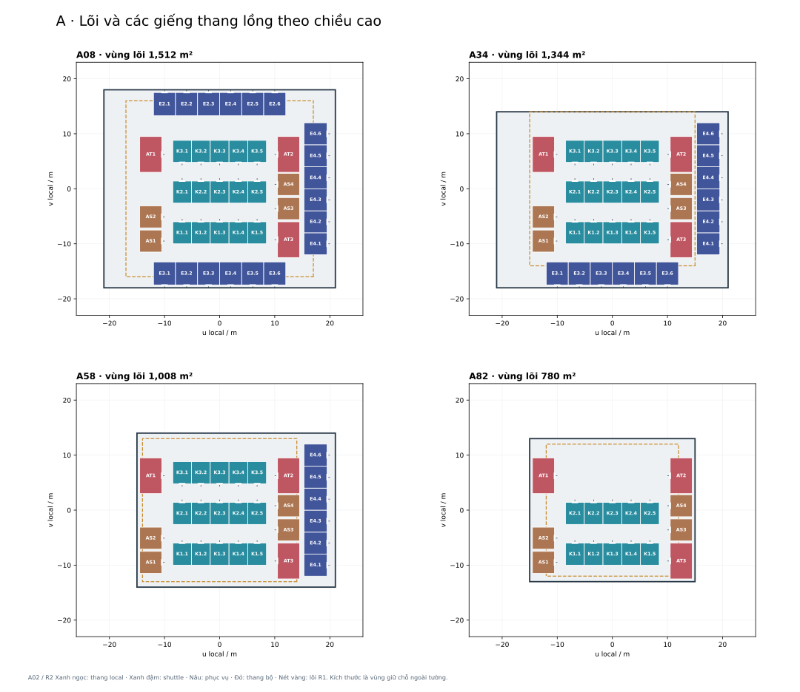
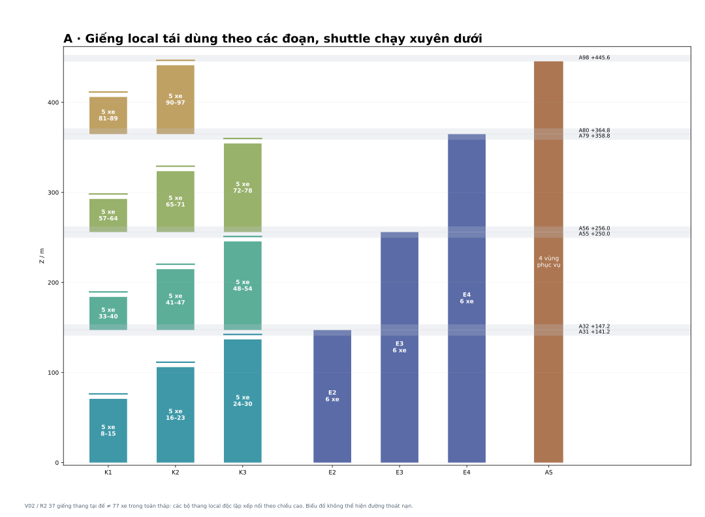
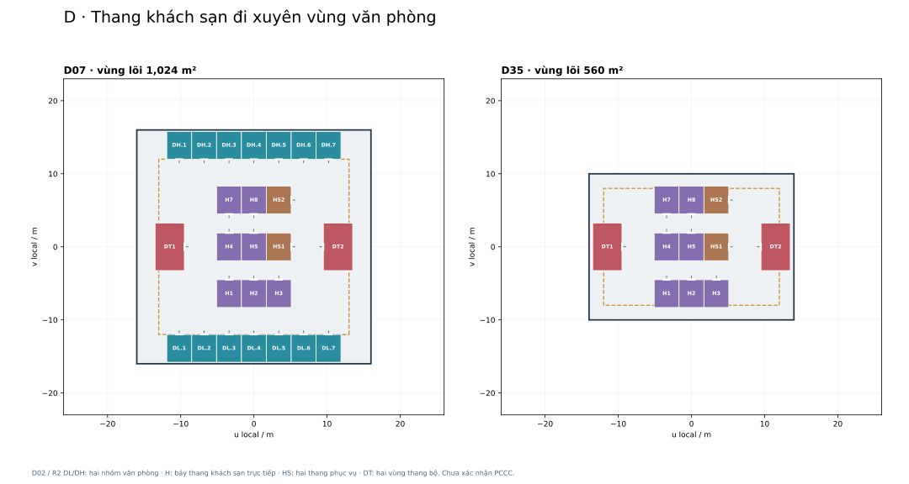
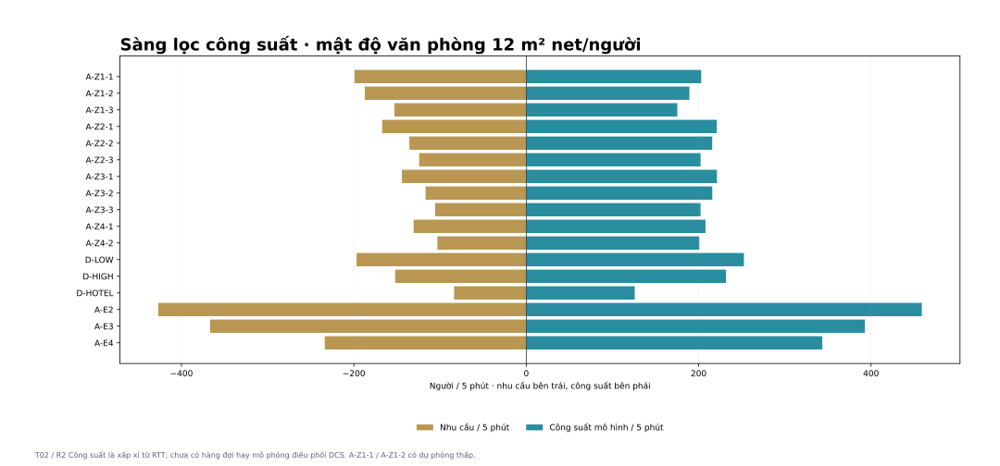
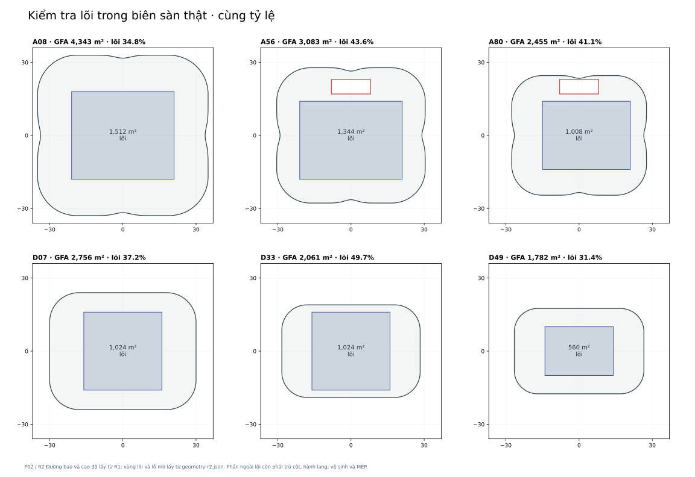
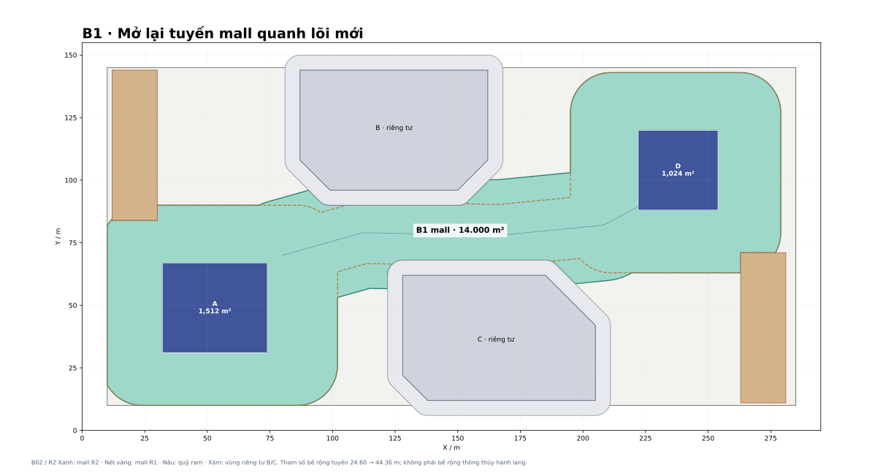

# HỘI LƯU · R2
## Kiểm tra lõi và giao thông đứng A/D
**Ngày phát hành 30/09/2026 (giờ Việt Nam) · Tiếp tục hồ sơ R1 · Đơn vị mét**

R2 đưa vùng giữ chỗ lõi thành một phương án giếng thang có tọa độ, các nhóm phục vụ và phép tính dân số. Phương án hiện tại giữ đường bao, số tầng và GFA của R1; thay đổi vùng lõi, một số lỗ mở và tuyến mall B1. Đây là phương án kiểm tra bằng thang một cabin, chưa phải cấu hình tối ưu để đặt mua.

**Kết luận chính:** bố trí hiện tại dùng lõi lớn hơn R1, làm giảm proxy diện tích văn phòng net khoảng 28.080 m² ở A và 9.360 m² ở D. Nó cho thấy giá phải trả để giữ vỏ tháp khi dùng cấu hình này, chứ chưa chứng minh các kích thước lõi là mức tối thiểu bắt buộc. Hai nhóm thang thấp A có dự phòng công suất rất nhỏ. Cần tối ưu điều phối/loại thang trước khi khóa lõi hoặc định giá cho thuê.

| Trạng thái | Thành phần |
| --- | --- |
| Giữ từ R1 | Đất 295×155 m; vị trí A/D/B/C; đế 6 tầng; A 98 tầng / 480 m; D 62 tầng / 285 m; ngân sách thân 300.000 / 120.000 m² |
| Đề xuất mới R2 | Lõi và giếng có tọa độ; A bốn vùng; D khách sạn trực tiếp; các lỗ mở được phối hợp lại; mall B1 vẫn 14.000 m² |
| Giả định để tính | 12 m² proxy net/người văn phòng; cao điểm 12%/5 phút; khách sạn 360 keys để thử tải; thông số động học và cabin sơ bộ |
| Chưa khóa | Nhà cung cấp, tiết diện tường chịu lực, mặt bằng phòng khách sạn, vận hành khách sạn hai chiều, PCCC, số thang mall/xe và tải phục vụ |

Nguồn: bản R1 đã lưu, mã Library `libfile_3b79feabef24819185e35ced52e4ae2b`. Thư mục `source-r1/` là bản tham chiếu. JSON R2 và bản vẽ R2 mới là nguồn cho những thay đổi tại lần này. OBJ bên trong nguồn R1 vẫn chứa lõi/lỗ mở cũ, chỉ dùng xem khối ngoài.

# 01 · Từ vùng giữ chỗ sang cấu trúc lõi
| Tháp / đoạn | Vùng local u / v, m | R1 → R2, m² | Lý do |
| --- | --- | --- | --- |
| A01–A33 | u −21..21; v −18..18 | 1.088 / 840 → 1.512 | Giữ 15 local + 18 express + 4 phục vụ; đầu giếng E2 |
| A34–A57 | u −21..21; v −18..14 | 840 / 728 → 1.344 | E2 đã kết thúc; giữ E3/E4 và đầu giếng E3 |
| A58–A81 | u −15..21; v −14..14 | 728 / 576 → 1.008 | E3 đã kết thúc; E4 giữ tới hết A81 |
| A82–A98 | u −15..15; v −13..13 | 576 → 780 | 10 local, 4 phục vụ, 3 vùng thang bộ và kỹ thuật |
| D01–D34 | u −16..16; v −16..16 | 624 → 1.024 | 14 văn phòng + 7 khách sạn + 2 phục vụ |
| D35–D62 | u −14..14; v −10..10 | 384 → 560 | Thang khách sạn và phục vụ liên tục |

Tâm tháp vẫn A (53;49), D (238;104). Tọa độ trên là hệ local, không phải tọa độ đất. Các lõi trên A giảm lệch về phía có shuttle kết thúc, tránh cắt một giếng thang còn đang đi xuyên. Lõi thu ở A34/A58/A82, sau tầng sky lobby và khoảng đầu giếng; không thu ngay tại A31/A55/A79.

Phần tô nhạt là toàn bộ quỹ lõi kiến trúc: tường, giếng, thang bộ, sảnh/circulation, MEP và vệ sinh còn phải phát triển. Các ô tô màu là module giữ chỗ **ngoài tường**, không phải kích thước cabin hoặc giếng thông thủy được hãng xác nhận. Ô AS là phục vụ; AT là thang bộ. A giữ ba vùng thang bộ, D hai vùng; số lượng và bề rộng thoát nạn chưa được xác nhận bởi phép tính dân số hay kiểm tra PCCC.

Các mũi cửa xác định phía mở sơ bộ. Lối local A đi qua hai sảnh giữa hàng K và các tuyến vòng ở hai bên. Các shuttle mở về phía ngoài lõi tại sảnh đế/sky lobby; ở tầng đi xuyên giếng đóng kín. Cần thiết kế sảnh mở ngoài lõi tại A01/A32/A56/A80 trong quỹ riêng/phụ trợ đã có. Phần nền nhạt chưa phải sơ đồ phân khoang, tường chịu lực hay hành lang chống khói.

Vùng lõi R2 nằm trong biên sàn thật của mọi tầng. Điều này kiểm tra được bằng polygon; việc có thể đặt cabin, counterweight, ray, cửa, hố pit và phòng máy thật trong từng module vẫn là bước riêng. Không có phép kiểm tra packing toàn cục chứng minh rằng một lõi nhỏ hơn không thể làm được.

# 02 · Tháp A: bốn vùng và ba tuyến shuttle

| Vùng | Tầng văn phòng | Tầng đón | Tổ chức local |
| --- | --- | --- | --- |
| Z1 | A08–A30 | Sảnh riêng A01 | 08–15 / 16–23 / 24–30, mỗi nhóm 5 xe |
| Z2 | A33–A54 | A32 +147,20 m | 33–40 / 41–47 / 48–54, mỗi nhóm 5 xe |
| Z3 | A57–A78 | A56 +256,00 m | 57–64 / 65–71 / 72–78, mỗi nhóm 5 xe |
| Z4 | A81–A97 | A80 +364,80 m | 81–89 / 90–97, mỗi nhóm 5 xe |

Khách Z1 đi từ sảnh A01 lên trực tiếp. Khách Z2/Z3/Z4 dùng ba nhóm E2/E3/E4 riêng, mỗi nhóm 6 xe express, lên đúng sky lobby rồi chuyển sang local. Không cho thang mall vận hành như một đoạn trong hành trình đi làm. A07 giữ phụ trợ/amenity theo R1; các lượt phát sinh ở đây chưa đưa vào mô hình cao điểm.

Tại đế có **37 giếng thang**: 15 local Z1, 18 shuttle và 4 phục vụ. Toàn tháp giữ chỗ **77 xe/bộ thang**: 55 local ở bốn đoạn, 18 shuttle, 4 phục vụ. Đây là 77 thiết bị riêng, không phải 77 giếng chạy suốt từ đất đến mái; cũng không phải tổng thang toàn dự án. Cấu hình có nhiều thiết bị vì chưa ghi nhận lợi ích DCS hoặc double-deck; mục đích hiện tại là bộc lộ quỹ không gian và chi phí vận hành của phương án một cabin.

Local mỗi vùng dùng lại các vị trí K ở đoạn trên, với máy, cabin và pit độc lập. Nhóm thấp chỉ chạy tới tầng cuối của nhóm nó; bảng nối kiểm tra tầng cuối cao nhất từng vùng là trường hợp chặt nhất. Ba hàng K là vị trí, không phải ba tuyến thang xuyên suốt 98 tầng.

| Cụm nối | Landing cuối dưới | Đầu giếng dưới, +5,5 m | Đáy pit trên, −2,0 m | Khoảng còn lại |
| --- | --- | --- | --- | --- |
| A30/A32 | +136.80 | +142.30 | +145.20 | 2.90 m |
| A54/A56 | +245.60 | +251.10 | +254.00 | 2.90 m |
| A78/A80 | +354.40 | +359.90 | +362.80 | 2.90 m |

Các khoảng nối còn phải dành tối thiểu 0,40 m cho slab giả định, cộng dầm/máy/đường tiếp cận thật. Số +5,5 m và −2,0 m là yêu cầu quỹ đang thử; không phải catalogue hãng. Đầu giếng shuttle giữ 6,5 m qua tầng cuối: E2 đến +153,70; E3 +262,50; E4 +371,30 m. Bởi vậy lõi chỉ thu từ A34, A58, A82.

AS1–AS4 là bốn vị trí phục vụ/cứu hỏa dự kiến; chức năng từng xe, phạm vi tầng và tải hàng chưa khóa. Không được tự gọi một ô AS là thang chữa cháy đạt chuẩn. Các tuyến dài gần toàn chiều cao tháp cần xác nhận travel, ray và chuyển vị công trình cùng hãng và kết cấu.

# 03 · Tháp D: tách khách sạn và văn phòng

Hai nhóm văn phòng DL/DH, mỗi nhóm 7 xe, từ sảnh văn phòng D01 lên D07–D19 hoặc D21–D33. D20/D34 là các tầng kỹ thuật/lánh nạn giữ chỗ; lượt phục vụ không được coi là một tầng văn phòng đông người.

Bảy thang khách sạn H đi **trực tiếp từ sảnh khách sạn D01** qua vùng văn phòng, dừng D35 và các tầng khách sạn được chọn. Khách không phải đổi cabin ở D35 để lên phòng. D35 vẫn giữ sky lobby, lounge và lớp kính lùi 3 m theo R1. Một số xe có thể được điều phối express lên lounge vào thời điểm cụ thể, nhưng không tính chúng thành nhóm express độc lập rồi cộng thêm xe lần nữa.

Hai HS đi từ BOH B1/đế lên vùng khách sạn, với cửa ở phía BOH; cần kiểm tra tách hàng sạch, hàng bẩn, rác và housekeeping. Bảy thang khách và hai thang phục vụ chạy xuyên lõi văn phòng. Thang văn phòng kết thúc D33; đầu giếng giả định +5,5 m đạt +152,70 m trong D34, trước khi thu lõi tại D35 +157,45 m.

**360 keys chỉ là tải thử**, gồm 20 tầng ×16 phòng và 4 tầng ×10 suite. D37–D47 + D49–D57 là 20 tầng thường, D58–D61 là bốn tầng suite. D36 dành phụ trợ/amenity để phối hợp lỗ thông với D35; D48/D62 giữ kỹ thuật. Đây chưa phải mặt bằng module phòng, không phải cam kết yield 360 phòng cao cấp.

Tải khách dùng 360×1,8+50 = 698 người để sàng lọc. Bảng RTT chỉ thử chiều từ sảnh lên; khách sạn có hai chiều, nhà hàng/lounges và thời điểm trả phòng, nên **chưa được xác nhận vận hành**. HS không góp vào công suất thang khách. D35/lounge và các sự kiện riêng cần thêm dân số và mô phỏng riêng.

# 04 · Cơ sở tính và giới hạn công suất
ISO 8100-32 đề cập việc lập kế hoạch, chọn thang cho văn phòng/khách sạn/nhà ở [1]. CIBSE Guide D 2025 phân biệt tính toán và mô phỏng [2–3]. R2 thực hiện phép sàng lọc bằng hành trình ngẫu nhiên, chưa thực hiện mô phỏng hàng đợi hoặc điều phối.

Proxy net từng tầng văn phòng = **0,90 × (GFA sàn − quỹ lõi)**. Sau khi trừ lõi, 10% tiếp theo dự trữ cho tổn thất sử dụng còn lại. Đây là proxy để tính dân số, không phải NLA chứng nhận: các cột, phòng MEP ngoài lõi, sảnh ngoài lõi và tỷ lệ phân chia khách thuê chưa có mặt bằng hoàn chỉnh. Không áp hệ số 90% lên GFA rồi trừ lõi thêm lần nữa.

Dân số = proxy net /12 m²; nhu cầu =12% dân số/5 phút. Mục tiêu nghiên cứu R2 là interval văn phòng ≤35 s, shuttle ≤30 s, khách sạn ≤40 s. **Các số này là giả định mục tiêu của dự án, không phải trích dẫn yêu cầu ISO/QCVN.** Nếu muốn mức 30 s cho mọi nhóm văn phòng, nhiều nhóm hiện tại cần tăng xe hoặc đổi điều phối.

Tổng dân số proxy: A **13.060**, văn phòng D **2.908**. Các tầng hỗ trợ/MEP không bị gán dân số văn phòng; tải phụ trợ có thật vẫn phải bổ sung khi công năng được khóa.

Mỗi nhóm lấy 12.000 chuyến, seed cố định 20260929. Một chuyến có P hành khách chọn tầng theo tỷ lệ dân số, dừng theo thứ tự tăng cao độ, rồi trở về terminal. Thời gian flight dùng profile gia tốc 1 m/s²: với d nhỏ hơn v²/a là 2√(d/a), còn lại d/v+v/a. Cộng 7 s mỗi điểm dừng/terminal cho cửa và leveling, cộng 2×P×1 s cho boarding/alighting. Khách sạn dùng 8 s và 1,2 s. Profile chưa mô tả jerk; các thông số phải thay bằng đường cong hãng.

HC = 300×số xe×P / RTT. Interval = RTT/số xe. **Interval không phải thời gian chờ đo được**; cũng không được cộng HC local và HC shuttle để tuyên bố công suất đường đi. Một hành trình A trên cao bị giới hạn bởi mắt xích yếu nhất.

| Nhóm | Tầng phục vụ | Xe | P / chuyến | RTT s | Interval s | HC / nhu cầu, người/5 phút |
| --- | --- | --- | --- | --- | --- | --- |
| A-Z1-1 | 8–15 | 5 | 22 | 162.6 | 32.5 | 203 / 199 |
| A-Z1-2 | 16–23 | 5 | 22 | 174.4 | 34.9 | 189 / 187 |
| A-Z1-3 | 24–30 | 5 | 20 | 171.2 | 34.2 | 175 / 153 |
| A-Z2-1 | 33–40 | 5 | 22 | 149.3 | 29.9 | 221 / 167 |
| A-Z2-2 | 41–47 | 5 | 22 | 153.0 | 30.6 | 216 / 136 |
| A-Z2-3 | 48–54 | 5 | 22 | 163.2 | 32.6 | 202 / 124 |
| A-Z3-1 | 57–64 | 5 | 22 | 149.2 | 29.8 | 221 / 144 |
| A-Z3-2 | 65–71 | 5 | 22 | 152.9 | 30.6 | 216 / 117 |
| A-Z3-3 | 72–78 | 5 | 22 | 163.2 | 32.6 | 202 / 106 |
| A-Z4-1 | 81–89 | 5 | 22 | 158.7 | 31.7 | 208 / 131 |
| A-Z4-2 | 90–97 | 5 | 22 | 164.4 | 32.9 | 201 / 103 |
| D-LOW | 7–19 | 7 | 26 | 216.2 | 30.9 | 252 / 197 |
| D-HIGH | 21–33 | 7 | 26 | 235.7 | 33.7 | 232 / 152 |
| D-HOTEL | 37–61 | 7 | 16 | 267.0 | 38.1 | 126 / 84 |
| A-E2 | 01 → 32 | 6 | 33 | 129.4 | 21.6 | 459 / 427 |
| A-E3 | 01 → 56 | 6 | 33 | 151.2 | 25.2 | 393 / 367 |
| A-E4 | 01 → 80 | 6 | 33 | 173.0 | 28.8 | 343 / 234 |

A-Z1-1 dự phòng khoảng 1.8%, A-Z1-2 khoảng 1.0%. Đây là mức rất mỏng, không nên khóa phương án như một hệ thống premium đã ổn định. Sai số lấy mẫu nhỏ không giải quyết được sai số giả định dân số, thời gian cửa hoặc lưu lượng người. Một ca thang ngừng hoạt động làm nhóm thấp A và một số tuyến shuttle thiếu công suất hoặc vượt interval.

Kịch bản 10 m² net/người làm ba nhóm local thấp A vượt HC; E2/E3 cũng thiếu công suất khi nâng dân số tương ứng. Mô hình cơ sở không được dùng cấp phép cho thuê mọi tầng ở mật độ 10 m²/người. Cần chạy cao điểm 15%, lunch/interfloor, mixed traffic, tải amenity và một xe ngừng hoạt động trong mô phỏng tiếp theo.

# 05 · Cabin cần được kiểm tra bằng diện tích
Bài trình bày CIBSE của Richard Peters chỉ rõ số người hiệu dụng phải kiểm tra bằng diện tích cabin, không thể chỉ lấy kg chia khối lượng người rồi nhân 80%; ví dụ diện tích mỗi người 0,21 m² cho văn phòng và 0,30 m² cho khách sạn/nhà ở [4]. R2 dùng các giá trị đó để đặt **yêu cầu diện tích cabin**, không giả định cabin lớn chỉ vì tải trọng ghi lớn.

Diện tích thông thủy yêu cầu = P × diện tích/người ÷0,80. Tải khởi điểm dưới đây là mục để trao đổi hãng; chưa chọn một sản phẩm đáp ứng đồng thời tải, diện tích, tốc độ và travel.

| Nhóm | P hiệu dụng | Diện tích cabin thông thủy tối thiểu ở 80% tải diện tích | Quỹ ngoài tường / giếng | Tải khởi điểm nghiên cứu |
| --- | --- | --- | --- | --- |
| Local A | 22 (nhóm cuối thấp 20) | 5,78 m² (P20: 5,25) | 3,40 × 4,00 m | ~3.200 kg |
| Shuttle A | 33 | 8,67 m² | 4,00 × 4,20 m | ~5.000 kg; cần cabin cao tốc lớn |
| Văn phòng D | 26 | 6,83 m² | 3,40 × 3,80 m | ~4.000 kg |
| Khách sạn D | 16, có hành lý | 6,00 m² | 3,40 × 3,80 m | ~3.200 kg |

Quỹ module bao gồm dự trữ tường và không được sử dụng như clear shaft. Các mức tải/cabin này khá lớn, nhất là shuttle A 10 m/s. Nếu hãng không cung cấp được cabin phù hợp trong module, phải đổi số xe, P, tốc độ hoặc lõi và chạy lại số học. Không được giữ P33 rồi âm thầm thay bằng cabin thông thường nhỏ hơn. Những phép kiểm tra polygon ở đây không chứng minh khả năng lắp thiết bị.

Khuyến nghị bước tối ưu: thử DCS trên dân số đã khóa; so cấu hình double-deck với single-deck; so 35 s và 30 s; dùng cabin area thật. Double-deck có thể giảm số giếng nhưng cần trả lại diện tích cho sảnh hai cao độ và lối chuyển. Các cặp A31/32, 55/56, 79/80 đều cách 6 m, phù hợp để nghiên cứu, nhưng tầng dưới đang giữ cho kỹ thuật/outrigger; cần tách luồng và kiểm tra pit local trước khi chọn.

# 06 · Điều chỉnh hình học và B1

Lỗ mở A32/A56/A80 đặt phía Đông trong R1 chồng lên tuyến E4 của bố trí mới. R2 chuyển chúng về phía +v (chưa phải Bắc địa lý), giữ mỗi lỗ **96 m²**: A32 u −8..8, v 18..24; A56/A80 u −8..8, v 17..23. A02 điều chỉnh hình lỗ/khuyết 1.950 m² để tránh lõi mới, giữ đúng diện tích khấu trừ và GFA tầng. Các thay đổi này có tọa độ trong JSON; OBJ R1 không phản ánh chúng.

Lõi xuyên B1 tăng A 1.088→1.512, D 624→1.024 m². Nếu chỉ trừ lõi mới khỏi mall cũ, diện tích còn **13.176 m²**, thiếu 824 m². R2 mở băng nối dưới quảng trường bằng phép giải diện tích, giữ hai anchor, quỹ ram và vùng riêng tư B/C. Tham số tạo băng tăng 24,60→44,36 m; nó không phải một hành lang mall thông thủy rộng 44 m. Mall thật còn bao gồm anchor, cửa hàng, khu BOH, lối đi và các lỗ lõi.

Mall B1 vẫn là một polygon liên thông **14.000 m²**; không chạm đế hoặc buffer riêng tư 6 m của B/C, không chồng quỹ ram. B1 còn lại 23.125 m² gồm đỗ xe, kỹ thuật và lõi. Quỹ mall đế A 21.000 + D 17.000 và B1 14.000 =52.000 m² gross vẫn được giữ **ở cấp budget**. R2 chưa chia cửa hàng và chưa chứng minh sảnh riêng lớn hơn vẫn nằm gọn trong 7.000/5.000 m² private của đế A/D; đó là điểm phải kiểm tra trước khi chốt mặt bằng mall.

B2–B5 mỗi tầng 37.125 m² vẫn chỉ để xe/kỹ thuật. Tổng 185.625 m² hầm không thay đổi. Quỹ ram 18×60 m ở R1 vẫn là vùng giữ chỗ, chưa có độ dốc hay bán kính quay thật. Chưa đưa ra số ô xe vì chưa có lưới cột, phòng máy, bể, đường chạy, phân khoang và hình học ram. Thang xe/mall được bố trí ngoài core thân và phải được bổ sung tọa độ/tải; không tính vào 77/23 thiết bị phía trên.

| Chỉ tiêu | R1 | R2 hiện tại | Sai khác |
| --- | --- | --- | --- |
| Proxy net văn phòng A | 184.799 | 156.719 | −28.080 m² |
| Proxy net văn phòng D | 44.261 | 34.901 | −9.360 m² |
| Mall B1 | 14.000 | 14.000 | 0 |
| Quỹ B1 còn lại | 23.125 | 23.125 | 0; gồm lõi và kỹ thuật |
| Tham số bề rộng tuyến mall | 24.60 m | 44.36 m | Mở băng dưới đất; quảng trường mặt đất vẫn theo R1 |
| GFA kiểm soát toàn khu | 631.690,24 | 631.690,24 | 0 |
| Dự phòng FAR | 8.459,76 | 8.459,76 | 0 |

# 07 · Checkpoint và bước phát triển tiếp
**3035/3035 điều kiện hình học/số học đạt** trong bản chạy này. Trong số đó có nhiều phép so chồng từng cặp module; số lượng lớn không có nghĩa hồ sơ đã gần thi công. Kiểm tra gồm lõi/lỗ mở trong biên từng tầng, bảo toàn GFA, module không chồng nhau, phần giếng còn hoạt động nằm trong lõi đúng đoạn, nối đầu giếng/pit theo giả định, B1 giữ diện tích/độ liên thông và 17 nhóm thang vượt phép sàng lọc cơ sở.

Không có kiểm tra: wall/core structural analysis, cabin CAD, fire/smoke compartment, travel-distance evacuation, manufacturer dispatch simulation, shaft clearances under drift, hotel room packing, detailed parking/ramp, operational resilience. Cụm “screen_pass” trong JSON chỉ chỉ điều kiện RTT/HC và interval của giả định tương ứng.

**Quyết định kiến trúc t đề xuất:** giữ vỏ R1 và dùng R2 này làm biên không gian để kiểm tra tiếp, chưa khóa lõi 1.512/1.024 m² như thiết kế tối ưu. Ưu tiên giải hai nhóm thấp A trước; song song lấy cabin/shaft/headroom từ hãng để so single-deck/DCS/double-deck. Chỉ sau đó khóa lõi, lập mặt bằng phòng D và phân chia mall. Mức net thất thoát hiện tại đủ lớn để yêu cầu tối ưu kỹ thuật trước khi phát triển nội thất hoặc phối cảnh.

| Gói việc tiếp | Sản phẩm cần ra |
| --- | --- |
| Tối ưu A | So số giếng, net floor, thời gian hành trình tổng và một xe hỏng; giải Z1 trước |
| Phối hợp hãng | Cabin area, tải, shaft clear, pit, overhead, machine space, travel từng nhóm |
| Lõi/kết cấu/PCCC | Tường và dầm thật, lobbies có bảo vệ, cầu thang/chiều rộng/lánh nạn phù hợp hồ sơ địa điểm |
| D phòng + vận hành | Module phòng trong biên thật; xác nhận keys, BOH, lounge, mixed hotel traffic |
| Hầm + đế | Lưới cột, ram thật, core/mall/parking lifts, private lobbies và cửa hàng trong gross budget |

## Tài liệu và cách dùng
`HOI_LUU_R2.html` chứa toàn bộ báo cáo/bản vẽ, đọc độc lập. `data/geometry-r2.json` là nguồn polygon/cao độ; `data/r2-study.json` chứa giả định, 17 nhóm, module và kiểm tra; hai CSV dùng trao đổi số liệu. Các SVG zoom không vỡ. `scripts/build_r2.py` và `build_drawings_report.py` tái tạo bộ này từ nguồn R1; không cần ảnh GenAI.

## Nguồn tham khảo kỹ thuật
1. [ISO 8100-32:2020 — phạm vi lập kế hoạch và chọn thang](https://www.iso.org/standard/73084.html). Chỉ sử dụng trang mô tả phạm vi; chưa tuyên bố tuân thủ toàn văn.
2. [CIBSE Guide D3 — Lift traffic design using calculation, 2025](https://www.cibse.org/knowledge-research/knowledge-portal/guide-d3-lift-traffic-design-using-calculation-2025/).
3. [CIBSE Guide D4 — Lift traffic design using simulation, 2025](https://www.cibse.org/knowledge-research/knowledge-portal/guide-d4-lift-traffic-design-using-simulation-2025/).
4. [Richard Peters / CIBSE — 80% Lift Traffic Design’s Most Misunderstood Number, 12/11/2025](https://www.cibse.org/media/x0sfnskv/80-lift-traffic-design-s-most-misunderstood-number-cibse.pdf). Tham chiếu điều kiện sức chứa theo diện tích cabin.
5. [KONE — Elevator planning handbook for architects](https://www.kone.com/en/Images/8559_Global_EN_Elevator_Planning_Handbook_tcm17-75237.pdf). Tham chiếu quy trình phối hợp early planning, shaft và overhead; không dùng để xác nhận sản phẩm cho R2.

Đây là nghiên cứu kiến trúc do trợ lý xây dựng theo hướng ưu tiên hình học/kết cấu; không phải tài liệu do SOM phát hành hoặc kiểm duyệt.
