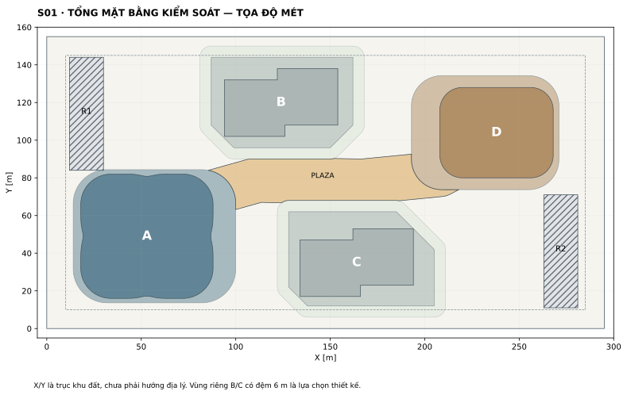
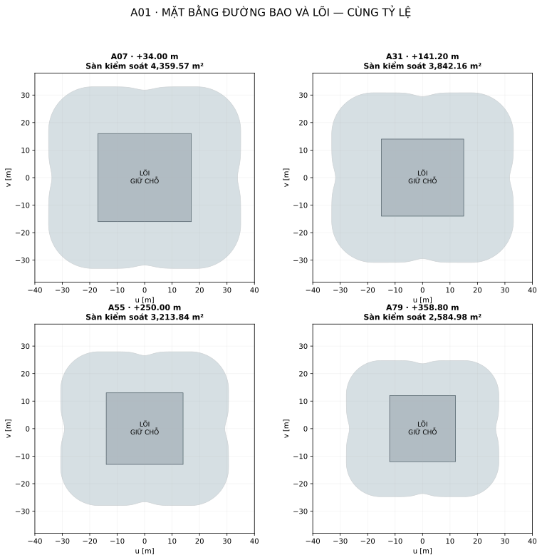
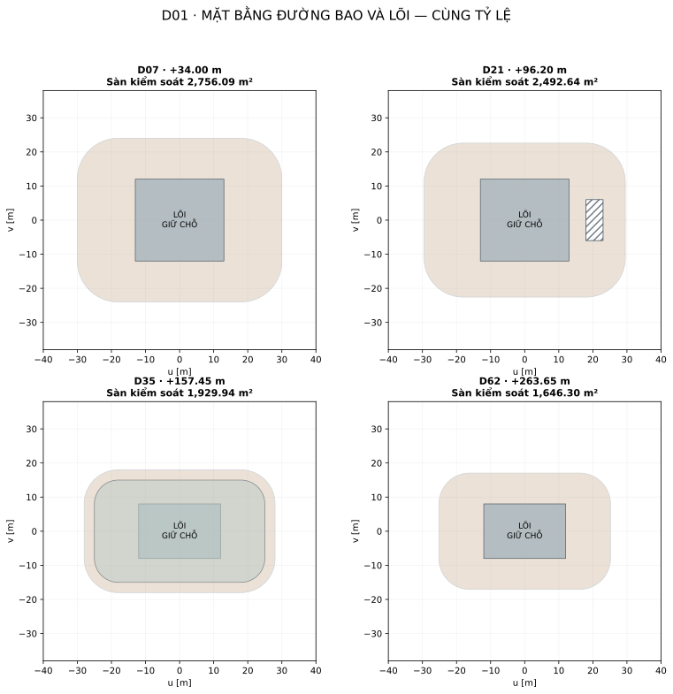
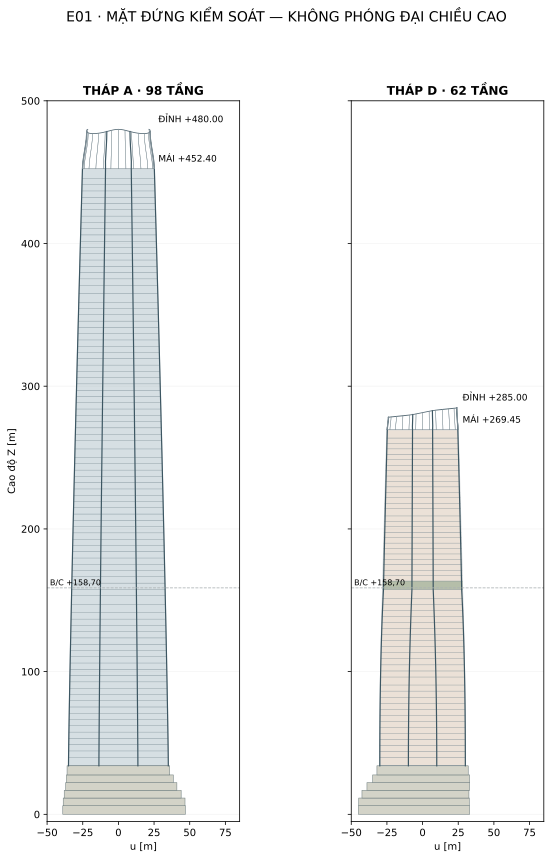
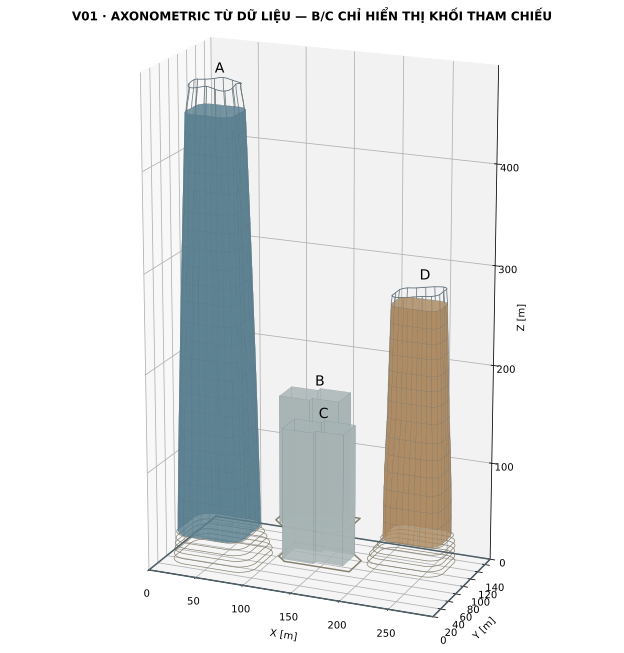

# 00 · HỘI LƯU R1 — Quyền ưu tiên dữ liệu và phạm vi

**Ngày phát hành: 30.09.2026 · Hệ mét · Thiết kế kiến trúc ở mức kiểm soát hình học.**

## Mục tiêu

Chuyển vision “A thuôn cao, D thấp hơn và thanh; đế mở về quảng trường chéo” thành một hệ hình học tái dựng được. A/D được thiết kế lại; vị trí tương đối, cấu hình duplex B/C và nguyên tắc mall B1 được kế thừa. Hồ sơ đủ để dựng mô hình khối, cao độ, biên sàn, lõi giữ chỗ, chân đế và crown theo cùng dữ liệu. Đây chưa phải mô hình BIM thi công, tính toán chịu lực hay hồ sơ cấp phép.

## Thứ tự ưu tiên khi có khác biệt

1. `data/geometry.json`: đường bao, cao độ, diện tích và vị trí công năng của lần phát hành R1.
2. `data/model-manifest.json`: quy tắc crown và chỗ lùi kính sky lobby dùng trong mô hình.
3. `data/floor-schedule.csv` và `data/outline-vertices.csv`: bảng kiểm tra và tọa độ xuất từ dữ liệu.
4. Bản vẽ SVG/PNG sinh bằng `scripts/build_views.py`.
5. Thuyết minh này; mọi kích thước làm tròn chỉ để đọc nhanh.
6. Phối cảnh GenAI trước đây: tham khảo cảm xúc và vật liệu, không được dùng đo tỷ lệ, số tầng, vị trí B/C hoặc diện tích.

Nếu phát hiện bất đồng giữa mục 1–4, dừng xuất bản bản dựng mới và sửa nguồn dữ liệu; không âm thầm nắn mô hình để giống ảnh.

## Trạng thái các quyết định

| Mức | Nội dung |
| --- | --- |
| Ràng buộc từ brief | Đất 295×155 m; FAR tối đa 14; mật độ tối đa 40%; B/C ≤40 tầng và 160 m; B2–B5 xe/kỹ thuật; mall B1 nối A/D, không vào đế B/C |
| Đường cơ sở R1 để dựng | A 98 tầng/480 m; D 62 tầng/285 m; tọa độ và profile trong JSON; 420.000 m² thân A/D; 50.000 m² đế A/D |
| Giữ chỗ kỹ thuật | Vùng lõi, tầng lánh nạn, MEP, liên kết cứng, ram và BOH; chưa xác nhận công suất hoặc kích thước thiết bị |
| Chưa xác lập | Hướng Bắc, mặt đường thật, chỉ giới thực tế, địa chất, mực nước, khảo sát gió, dân số tính toán, yêu cầu vận hành khách sạn |

## Các sửa đổi quan trọng so với lời mô tả trước

- A sử dụng hình chữ nhật bo góc có bốn rãnh lõm nông; diện tích chân tháp thực được tính từ đa giác, không lấy tròn 4.400 m².
- Tầng đế trên cùng A có đường bao 4.600 m², đủ bao chân thân tháp. 4.300 m² là sàn sau lỗ mở, không phải đường bao 3.000 m² như phương án phân bổ trước.
- Đế D trên cùng có đường bao 3.000 m²; sàn sau lỗ mở 2.850 m².
- A/D không xoay từng tầng. Mặt bằng co theo công thức; tâm tháp cố định.
- Crown là hệ gân/khung có cao độ rõ; không chứa thêm một số tầng vô hình ngoài bảng GFA.
- B/C trong OBJ chỉ là khối tham chiếu, không thay thế tài liệu duplex nguồn.

## Tham chiếu thiết kế

Đây là phương án tự phát triển từ các nguyên tắc tham khảo, không phải tài liệu của SOM. Nguồn chính đã nghiên cứu: [Tianjin CTF](https://www.som.com/projects/tianjin-ctf-finance-centre/), [One Century](https://www.som.com/projects/one-century/), [Manhattan West](https://www.som.com/projects/manhattan-west-development/), [Greenland Hangzhou Century Center](https://www.som.com/projects/greenland-hangzhou-century-center/). Tiếp thu quan hệ công năng–hình khối, biểu hiện kết cấu, sảnh mở và tính liên tục của mặt dựng; không sao chép tỷ lệ hay cấu kiện của một dự án cụ thể.


# 01 · Ngân sách diện tích và cách đếm

| Thành phần | m² |
| --- | --- |
| Đất | 45.725,00 |
| Trần FAR | 640.150,00 |
| Thân A | 300.000,00 |
| Thân D — gói văn phòng | 70.000,00 |
| Thân D — gói khách sạn | 50.000,00 |
| Đế A | 28.000,00 |
| Đế D | 22.000,00 |
| Thân B/C, theo nguồn duplex R1 | 119.690,24 |
| Đế riêng B/C, ngân sách kế thừa | 28.000,00 |
| Mall B1, diện tích phân khu bảo thủ | 14.000,00 |
| Tổng diện tích kiểm soát | 631.690,24 |
| Biên còn lại | 8.459,76 |

**FAR kiểm soát = 13,81499.** Biên 8.459,76 m² tương đương khoảng 1,32% trần FAR; không nên dùng hết trước khi hoàn tất lõi và MEP.

## Ba trường diện tích phải phân biệt

- `envelope_area`: diện tích đa giác đường bao sàn tại cốt sàn.
- `void_area`: tổng lỗ mở kiến trúc hoặc vùng cắt khỏi sàn đã mô tả bằng hình học.
- `slab_area = envelope_area − void_area`: diện tích kiểm soát R1. Đây là quy ước sàn gộp kiến trúc; vẫn giữ diện tích lõi/giếng đứng chưa khai triển và các diện tích kỹ thuật, lánh nạn. Không phải diện tích bê tông đặt hàng, diện tích cho thuê hay kết quả tính FAR pháp lý.

Các tầng kỹ thuật, sảnh trên cao và tiện ích đã nằm trong gói 300.000/120.000 m². Không cộng thêm chúng sau khi chia GFA cho diện tích sàn điển hình. Các ban công/vườn trong đường bao đang được tính bảo thủ; việc được trừ hay phải tính sẽ phân loại ở bước pháp lý sau.

## Kiểm soát mật độ

Đế A 5.800 + đế D 4.500 + đế B 3.456 + đế C 3.600 = 17.356 m². Giữ thêm 400 m² cho công trình phụ, tổng 17.756,00 m², mật độ 38,83%. Còn 534 m² tới trần 18.290 m². Thân tháp và các tầng đế trên đã được kiểm tra nằm trong đường bao tầng một; không cộng trùng footprint thân vào footprint đế.

Khoản 400 m² là dự trù, chưa có hình học công trình phụ. Mái che lối vào, đầu ram, trạm kỹ thuật và phần nhô cần được thống kê ở lần sau. Diện tích trống còn lại không tự động là diện tích cây xanh: gồm quảng trường, đường xe, ram, mặt nước và các khoảng đệm.

## Tổng sàn hầm và tổng quy mô

Hầm theo đường bao 275×135 = 37.125 m² mỗi tầng; năm tầng là 185.625 m². Trong đó mall B1 14.000 m² đã nằm trong bảng FAR kiểm soát. Phần còn lại 171.625 m² là quỹ xe/kỹ thuật và giao thông, chưa phải sàn đỗ xe hữu dụng.

Diện tích trên mặt đất theo cùng quy ước là 617.690,24 m². Cộng toàn bộ đường bao hầm cho ra 803.315,24 m² quy mô hình học sơ bộ. Tổng này không phải BOQ bê tông và chưa trừ tất cả các lỗ ram, giếng kỹ thuật hay khoảng thông tầng hầm.


# 02 · Hệ tọa độ, tổng mặt bằng và giao tiếp

Gốc tại góc khu đất (0;0). X dọc cạnh 295 m; Y dọc cạnh 155 m; Z hướng lên, ±0,00 tại nền tiếp cận giả định. **Không gắn X/Y với Đông/Tây/Bắc/Nam.** Đơn vị tất cả tọa độ là mét. Không tự thêm cốt nền +1,10 m từ một dự án khác.

| Tháp | Tâm X | Tâm Y | Góc xoay |
| --- | --- | --- | --- |
| A | 53 | 49 | 0° (B/C theo phép biến đổi nguồn) |
| B | 124 | 120 | 0° (B/C theo phép biến đổi nguồn) |
| C | 164 | 35 | 0° (B/C theo phép biến đổi nguồn) |
| D | 238 | 104 | 0° (B/C theo phép biến đổi nguồn) |



*S01 — Biên đế, chân tháp, tuyến quảng trường và vùng riêng tư.*

## B/C giữ nguyên

B: X=94+u, Y=102+v. C: X=194−u, Y=53−v. Polygon local gồm (0,0),(32,0),(32,6),(60,6),(60,36),(28,36),(28,30),(0,30). Footprint 1.824 m²/tháp. Mỗi tháp 92 căn duplex, 40 tầng vật lý, mái +154,20 m, crown +158,70 m.

Các lõi và phần chia căn của B/C lấy từ `bc-source-r1.json`; mô hình tổng thể chỉ dựng đường bao để kiểm tra tương quan. Ngân sách đế B/C 14.000 m²/tháp chưa được chia thành mặt bằng mới trong gói này.

## A/D và quảng trường

Tâm A=(53;49), tâm D=(238;104). Hai trục tháp không nghiêng và không xoay theo tầng. Các đế có tâm dịch dần về tâm tháp khi lên cao, tạo khoảng lùi về phía quảng trường.

Tim tuyến đi bộ kiểm soát: (80;70) → (112;79) → (167;78) → (208;82) → (229;93). Vùng tuyến rộng cơ sở 24 m, cắt khỏi các đế và vùng đệm B/C. Phần tim đi vào đế A/D chỉ định hướng sảnh mall; phần quảng trường ngoài trời là polygon còn lại trong JSON.

Vùng đệm 6 m quanh đế B/C là lựa chọn bố trí riêng tư, không phải khoảng cách pháp quy đã xác nhận. Khi triển khai đường xe chữa cháy, đường dạo và cây xanh, cần phân định lại từng dải.

## Khoảng cách hình học ngắn nhất giữa chân các thân tháp

| Cặp tháp | Khoảng cách m |
| --- | --- |
| A–D | 122,27 |
| A–B | 26,19 |
| A–C | 46,00 |
| D–B | 54,00 |
| D–C | 34,87 |
| B–C | 55,58 |

Đây là khoảng cách giữa polygon mặt đứng ngoài chân tháp, không phải kết luận đạt yêu cầu chiếu sáng, riêng tư, thoát nạn hoặc cứu hỏa. A–B là cặp cần khảo sát kỹ nhất khi triển khai mặt dựng và loggia B. Chưa có hướng địa lý nên chưa xác lập hướng che nắng hay cửa nhìn.

## Tiếp cận vận hành

- A: sảnh văn phòng tiếp cận từ mép ngoài khu đất; cửa mall hướng vào quảng trường. Hai tuyến chỉ giao tiếp qua ranh kiểm soát rõ.
- D: tách cửa văn phòng, cửa khách sạn và đường phục vụ; sảnh khách sạn không sử dụng hành lang mall làm tuyến đến bắt buộc.
- B/C: tiếp cận cư dân từ phía ngoài cụm; không mở sảnh mall, thang cuốn hoặc cửa thoát dòng thương mại qua đế căn hộ.
- Hai vùng ram là giữ chỗ mặt bằng. Đấu nối với đường công cộng chỉ được chốt sau khi có hồ sơ mặt đường thật.


# 03 · Tháp A — hình học, cao độ và tổ chức công năng

**98 tầng vật lý = 6 tầng đế + 92 tầng thân. Thân 300.000 m²; đế 28.000 m².** Mái kết cấu kiểm soát +452,40 m; đỉnh kiến trúc +480,00 m. Không tính crown thành tầng khai thác bổ sung.

## Luật tạo hình tái dựng được

Tại cao độ z trong đoạn 34,00–452,40 m:

```text
t = clamp((z−34,00)/418,40, 0, 1)
q = t ^ 1.205238426409
W = 70 × (1−0,28q)
H = 66 × (1−0,34q)
R = 16 × (1−0,30q)
d = (1,2+0,4 sin(πt)) × (1−0,30q)
```

Tạo hình chữ nhật bo góc W×H, bán kính R. Lấy 256 điểm theo chiều dài chu vi, bắt đầu tại trung điểm mặt +X, chạy ngược chiều kim đồng hồ. Với mỗi điểm local (u,v), đặt θ=atan2(v,u); Δ là khoảng góc nhỏ nhất tới một trong bốn trục 0°,90°,180°,270°. Co bán kính của điểm một lượng `d × exp[−(Δ/0,14)²]`. Quy tắc này tạo bốn rãnh lõm nông giữa bốn mặt. Sau đó cộng tâm (53;49).

Số mũ được giải bằng tổng diện tích của các tầng thật, có trừ ba lỗ mở 96 m²; không nội suy từ một diện tích sàn trung bình. Đường bao chân thân A tại A07 có diện tích 4.359,57 m². Kích thước W/H là kích thước hạt giống bo góc, không đồng nhất tuyệt đối với bounding box sau biến dạng.

## Các mốc kiểm tra

| Tầng | Z m | Cao tầng m | W m | H m | Sàn m² | Công năng |
| --- | --- | --- | --- | --- | --- | --- |
| A07 | 34,00 | 6,00 | 70,00 | 66,00 | 4.359,57 | Sky lobby/support |
| A30 | 136,80 | 4,40 | 66,39 | 61,87 | 3.866,72 | Office |
| A31 | 141,20 | 6,00 | 66,20 | 61,65 | 3.842,16 | MEP/refuge/outrigger reservation |
| A32 | 147,20 | 6,00 | 65,95 | 61,36 | 3.712,48 | Sky lobby/support |
| A54 | 245,60 | 4,40 | 61,38 | 56,13 | 3.239,56 | Office |
| A55 | 250,00 | 6,00 | 61,17 | 55,89 | 3.213,84 | MEP/refuge/outrigger reservation |
| A56 | 256,00 | 6,00 | 60,87 | 55,55 | 3.082,77 | Sky lobby/support |
| A78 | 354,40 | 4,40 | 55,79 | 49,73 | 2.609,95 | Office |
| A79 | 358,80 | 6,00 | 55,56 | 49,46 | 2.584,98 | MEP/refuge/outrigger reservation |
| A80 | 364,80 | 6,00 | 55,23 | 49,09 | 2.455,00 | Sky lobby/support |
| A97 | 441,20 | 4,40 | 51,03 | 44,28 | 2.128,29 | Office |
| A98 | 445,60 | 6,80 | 50,78 | 44,00 | 2.104,57 | MEP/refuge/outrigger reservation |



*A01 — Bốn mặt bằng A cùng tỷ lệ; lõi là vùng giữ chỗ.*

## Tầng và chiều cao

A01–A06 là đế, tổng cao 34 m. Tầng thân điển hình cao 4,40 m. A07, A31, A32, A55, A56, A79, A80 cao 6,00 m; A98 cao 6,80 m. Các tầng còn lại giữ 4,40 m. CSV cung cấp đủ 98 dòng, không bỏ số tầng vì lý do thương mại.

A31/A55/A79 là vùng dự trữ lánh nạn, kỹ thuật và liên kết cứng. A32/A56/A80 có sảnh trên cao/phụ trợ và một lỗ mở local u=18..24, v=−8..8 m. Mỗi lỗ rộng 6×16=96 m². Cấu hình tầng lánh nạn và phân vùng cháy này mới là đề xuất không gian, chưa xác nhận theo quy chuẩn áp dụng.

## Lõi và văn phòng

| Đoạn | Vùng lõi local | Diện tích giữ chỗ |
| --- | --- | --- |
| A07–A30 | u=±17; v=±16 | 1.088 m² |
| A31–A54 | u=±15; v=±14 | 840 m² |
| A55–A78 | u=±14; v=±13 | 728 m² |
| A79–A98 | u=±12; v=±12 | 576 m² |

Các hình chữ nhật lồng nhau giúp duy trì phần lõi xuyên suốt. Việc giảm vùng lõi là giảm vùng bao kiến trúc; không có nghĩa được phép cắt bỏ tường chịu lực ở đúng cao độ đó mà không phân tích. Nhóm thang thấp kết thúc trước, phần thang cao và tuyến kỹ thuật tiếp tục trong vùng lõi trong. Chưa chốt số thang, tải trọng hoặc tốc độ.

Vành văn phòng thấp có chiều sâu danh nghĩa khoảng 17–18 m ở các trục chính. Cần nghiên cứu dầm/sàn và cột phụ; chưa cam kết một không gian không cột trên toàn bộ nhịp này. Vùng giữa ưu tiên mặt bằng chia 2–4 khách thuê; vùng cao có thể cho thuê toàn tầng. Diện tích net-lettable chưa được tính.

## Những giới hạn khi dựng

Giữ tâm đứng; không xoay loft; không đổi từng đoạn thành hộp giật cấp. Không khoét các rãnh thành khe xuyên qua toàn bộ tháp. Không thêm sân vườn toàn chu vi trên A chỉ vì ảnh phối cảnh có mảng xanh. Các khoảng thông tầng chỉ tồn tại khi có tọa độ trong JSON.


# 04 · Tháp D — văn phòng, khách sạn và sky lobby

**62 tầng vật lý = 6 tầng đế + 56 tầng thân.** D07–D34 là gói văn phòng 70.000 m²; D35–D62 là gói khách sạn 50.000 m². Tổng thân 120.000 m², chưa bao gồm 22.000 m² đế. Trong từng gói đã có sảnh, lõi, kỹ thuật và lánh nạn.

## Profile theo công năng

Đoạn văn phòng: t=(z−34)/(157,45−34), q=t^2.103257151817; W=60−4q, H=48−12q, R=12−2q.

Đoạn khách sạn: t=(z−157,45)/(269,45−157,45), q=t^1.071919145920; W=56−6q, H=36−2q, R=10−q.

Mỗi đoạn dùng hình chữ nhật bo góc, 256 điểm theo chu vi, cùng tâm (238;104). Hai profile gặp nhau ở 56×36 m, R=10 m tại +157,45 m: không có bước nhảy kích thước ở ranh công năng. Đạo hàm đường bao có thể đổi ở đây; vùng sky lobby và các gân đứng xử lý chuyển tiếp. Không dùng smooth modifier làm thay đổi biên sàn đã tính.

| Tầng | Z m | Cao tầng m | W m | H m | Sàn m² | Công năng |
| --- | --- | --- | --- | --- | --- | --- |
| D07 | 34,00 | 5,60 | 60,00 | 48,00 | 2.756,09 | Office |
| D20 | 90,60 | 5,60 | 59,22 | 45,67 | 2.588,89 | MEP/refuge reservation |
| D21 | 96,20 | 4,25 | 59,05 | 45,16 | 2.492,64 | Office |
| D34 | 151,45 | 6,00 | 56,40 | 37,19 | 2.008,14 | MEP/refuge reservation |
| D35 | 157,45 | 6,00 | 56,00 | 36,00 | 1.929,94 | Hotel sky lobby |
| D36 | 163,45 | 3,80 | 55,74 | 35,91 | 1.836,47 | Hotel |
| D48 | 209,05 | 5,20 | 53,39 | 35,13 | 1.796,63 | MEP/refuge reservation |
| D62 | 263,65 | 5,80 | 50,33 | 34,11 | 1.646,30 | MEP/refuge reservation |



*D01 — Đường bao D và vùng lõi; D35 có vùng kính lùi 3 m.*

## Cao độ và khoảng lùi

Đế kết thúc +34,00 m. Văn phòng điển hình 4,25 m; D07/D20 cao 5,60 m, D34 cao 6,00 m. Khách sạn điển hình 3,80 m; D35 cao 6,00 m, D48 cao 5,20 m, D62 cao 5,80 m. Mái +269,45 m, crown cao từ +278,00 đến +285,00 m.

Sky lobby bắt đầu D35, +157,45 m. Từ +157,45 đến +163,45 m, kính lùi vào 3 m so với đường bao sàn bằng phép offset polygon. Gân ngoài tiếp tục theo biên thân. Vùng vành sàn ngoài kính là sân vườn/hiên có mái ở mức concept; được giữ trong diện tích kiểm soát bảo thủ. Không cộng thêm diện tích sky garden ngoài 120.000 m².

D21 có lỗ mở 5×12=60 m² tại u=18..23, v=−6..6. D36 có lỗ mở 5×16=80 m² tại u=16..21, v=−8..8; liên hệ với sảnh dưới. Chưa đặt bể bơi hay ballroom trên cao vì chúng sẽ thay đổi tải trọng và tổ chức kỹ thuật.

## Lõi và các luồng riêng

Vùng lõi văn phòng: 26×24=624 m², tâm tại tâm tháp. Vùng lõi khách sạn: 24×16=384 m², lồng trong lõi dưới. Hệ express khách sạn và hệ phục vụ phải đi xuyên vùng lõi dưới; khoảng 240 m² chênh lệch chỉ là quỹ cho tổ chức thang văn phòng, sảnh và kỹ thuật, không phải diện tích tự do chắc chắn.

| Luồng | Tuyến bắt buộc |
| --- | --- |
| Nhân viên/khách văn phòng | Sảnh văn phòng → kiểm soát → thang văn phòng |
| Khách khách sạn | Drop-off riêng → sảnh dưới → express → sky lobby → thang phòng |
| Nhân viên và hàng khách sạn | BOH B1/đế → thang phục vụ → kho tầng/bếp/housekeeping |
| Khách mall | A/B1/D → thang cuốn thương mại; không dùng thang khách sạn làm tuyến xuyên |

Số phòng chưa chốt. Cần chọn module phòng, tỷ lệ suite, diện tích nhà hàng/club/housekeeping và mô phỏng thang trước khi suy ra số keys. Vành khách sạn tại phần thấp có chiều sâu trục ngắn khoảng (36−16)/2=10 m, bao gồm cả phần hành lang/tường khi phát triển mặt bằng.


# 05 · Khối đế, mall và năm tầng hầm

| Tầng | Z | Cao | Tâm X | W | H | Bao sàn | Lỗ/cắt | Sàn kiểm soát |
| --- | --- | --- | --- | --- | --- | --- | --- | --- |
| A01 | 0,00 | 6,00 | 57,00 | 86,00 | 70,68 | 5.800,00 | 300,00 | 5.500,00 |
| A02 | 6,00 | 5,40 | 57,00 | 85,40 | 70,59 | 5.750,00 | 1.950,00 | 3.800,00 |
| A03 | 11,40 | 5,40 | 56,00 | 82,00 | 70,47 | 5.500,00 | 500,00 | 5.000,00 |
| A04 | 16,80 | 5,40 | 55,00 | 78,00 | 69,85 | 5.200,00 | 400,00 | 4.800,00 |
| A05 | 22,20 | 5,40 | 54,00 | 75,00 | 68,46 | 4.900,00 | 300,00 | 4.600,00 |
| A06 | 27,60 | 6,40 | 53,00 | 72,00 | 66,95 | 4.600,00 | 300,00 | 4.300,00 |
| D01 | 0,00 | 6,00 | 232,00 | 78,00 | 60,52 | 4.500,00 | 100,00 | 4.400,00 |
| D02 | 6,00 | 5,40 | 232,00 | 77,50 | 60,26 | 4.450,00 | 800,00 | 3.650,00 |
| D03 | 11,40 | 5,40 | 233,00 | 75,00 | 59,25 | 4.250,00 | 200,00 | 4.050,00 |
| D04 | 16,80 | 5,40 | 235,00 | 72,00 | 56,51 | 3.900,00 | 150,00 | 3.750,00 |
| D05 | 22,20 | 5,40 | 237,00 | 68,00 | 52,87 | 3.450,00 | 150,00 | 3.300,00 |
| D06 | 27,60 | 6,40 | 238,00 | 64,00 | 48,81 | 3.000,00 | 150,00 | 2.850,00 |

Tất cả đế A/D có tâm Y cố định lần lượt 49/104 m. Tâm X và kích thước thay đổi theo bảng. Bán kính và tọa độ đầy đủ trong JSON/CSV. Lỗ/cắt sàn được lưu bằng polygon: một phần là atrium, một phần là khoảng lùi hoặc thông tầng sảnh. Không mặc định tất cả diện tích này là giếng trời nằm giữa khối.

## Tiếp đất

Thân A có đường bao chân khoảng 4.360 m²; đường bao đế trên cùng 4.600 m². Thân D có đường bao chân khoảng 2.756 m²; đế trên cùng 3.000 m². Kiểm tra bao hình cho tất cả sáu tầng đế đã thực hiện. Các lỗ sàn vẫn có thể cho cột đi xuyên; không quảng cáo một sảnh hoàn toàn không cột khi chưa có giải pháp kết cấu.

Mép đế phía quảng trường lùi dần: A có phần vươn sang +X, D sang −X. Mặt tiền thấp, khoảng hiên và sân nhà hàng cần được triển khai theo chính các đường bao này. Hình R1 có độ lùi vừa phải do phần thân A khá lớn; ảnh phối cảnh với một podium rất rộng hoặc thân tháp rất mảnh ở chân không phải đường cơ sở.

## Phân bổ công năng đế — ngân sách, chưa phải NLA

| Khối | Mall và phụ trợ mall | Sảnh/lõi/phụ trợ tháp | Tổng |
| --- | --- | --- | --- |
| A | 21.000 m² | 7.000 m² | 28.000 m² |
| D | 17.000 m² | 5.000 m² | 22.000 m² |
| B1 | 14.000 m² phân khu mall | nằm trong vùng xe/kỹ thuật đối với lõi riêng | 14.000 m² mall |

Tổng quỹ mall 52.000 m² gồm cả giao thông và BOH, không phải diện tích cho thuê. Bố trí retail/F&B ở A01–A03 và D01–D03; các tầng cao hơn có thể có giải trí, ăn uống, dịch vụ và tiện ích tháp. Ballroom khách sạn nếu phát triển phải lấy từ quỹ 5.000 m² phụ trợ đế D hoặc điều chỉnh lại ngân sách rõ ràng.

## Hầm

| Tầng | Cốt sàn | Chiều cao danh nghĩa | Diện tích đường bao | Mall | Xe/kỹ thuật |
| --- | --- | --- | --- | --- | --- |
| B1 | −6,00 m | 6,00 m | 37.125 m² | 14.000 m² | 23.125 m² |
| B2 | −9,60 m | 3,60 m | 37.125 m² | 0 | 37.125 m² |
| B3 | −13,20 m | 3,60 m | 37.125 m² | 0 | 37.125 m² |
| B4 | −16,80 m | 3,60 m | 37.125 m² | 0 | 37.125 m² |
| B5 | −20,40 m | 3,60 m | 37.125 m² | 0 | 37.125 m² |

Cốt B5 không phải đáy đào hay đáy đài móng. Chiều cao danh nghĩa chưa trừ kết cấu sàn và MEP. Đường bao hầm lùi 10 m là giả định thiết kế, chưa phải chỉ giới được phê duyệt.


*S02 — Mall B1 và phần xe/kỹ thuật còn lại, dựng từ các polygon thực.*

## Hình học mall B1

Hai vùng đầu A/D là các đường bao rộng hơn đế trên mặt đất. Chúng nối qua vùng đệm quanh tim quảng trường; bề rộng tham số trước khi cắt là 24,60 m. Sau khi trừ đệm B/C, lõi A/D và vùng ram, polygon liên tục còn đúng 14.000 m². Độ rộng tại từng điểm thay đổi do các phép cắt; con số này không phải toàn bộ bề rộng hành lang đi bộ.

Hai lõi riêng trừ khỏi mall: A tại X=36..70, Y=33..65; D tại X=225..251, Y=92..116. Đệm sáu mét quanh footprint đế B/C không thuộc mall. Kết nối kiểm soát từ gara vào sảnh cư dân sẽ thiết kế trong vùng riêng; không mở một đường mall xuyên đế căn hộ.

## Ram, nhận hàng và giới hạn hiện tại

- R1: X=12..30, Y=84..144; R2: X=263..281, Y=11..71. Mỗi vùng 18×60=1.080 m², nằm ngoài mall và trong đường bao hầm.
- Đây là vùng giữ chỗ, chưa phải tuyến ram đã giải độ dốc. Dốc xuống B1 sâu 6 m cần kiểm tra chiều dài hữu dụng, đoạn chuyển, bán kính quay, cao độ qua dầm và khả năng vào/ra cùng lúc.
- BOH A: X=22..42, Y=15..27, 240 m². BOH D: X=253..270, Y=119..131, 204 m². Cả hai nằm trong polygon mall B1. Kích thước vùng này chưa chứng minh được khả năng quay xe tải; có thể dùng điểm nhận hàng xe nhỏ và tổ chức chuyển tải theo khung giờ.
- Chưa tính số chỗ xe. Phải trừ ram, lõi, phòng máy, đường xe, cột và vùng quay xe trước khi tính capacity.
- Chưa khoét sân chìm hay giếng trời xuyên bản đế ở R1. Các khoảng mở đó chỉ được bổ sung sau khi xác định vị trí cột, ram, phân khoang và chống thấm; mọi lỗ mới phải vào dữ liệu diện tích.

Hầm liên thông là liên thông xây dựng và giao thông có kiểm soát, không đồng nghĩa mọi nhóm sử dụng được đi xuyên mọi phân khu.


# 06 · Khung kết cấu, lõi và hệ thống cần phối hợp

## Mức độ của tài liệu

Phần này xác định đường truyền lực và không gian cần giữ để kiến trúc không tự mâu thuẫn. Chưa có tải trọng tính toán, kích thước cột/tường được kiểm chứng, lượng thép, móng, chuyển vị, gia tốc gió hoặc phân tích động đất. Các gân trong OBJ là hình học biểu đạt kiến trúc; không được lấy tiết diện gân làm tiết diện cột.

## Tháp A

Hệ nghiên cứu: lõi trung tâm kết hợp cột lớn ở biên, cột phụ chịu tải đứng và các tầng liên kết cứng. Tám đường gân lớn định hướng tại góc polar 22,5°+45°k; đường tâm kết cấu dự kiến lùi vào mặt dựng, phải được chọn lại cùng lưới cột thực. Lõi không nghiêng; đường biên và cột biên có thể nghiêng theo profile.

Tuyến tải đứng: sàn → dầm/sàn chịu lực → cột/lõi → đài/móng. Tuyến tải ngang nghiên cứu: mặt dựng/sàn diaphragm → lõi và hệ biên → liên kết cứng → móng. Độ cong của vỏ ngoài chưa chứng minh bất kỳ mức tiết kiệm vật liệu nào.

Các cụm A31–A32, A55–A56, A79–A80 là quỹ không gian để phối hợp outrigger/belt, MEP và sky lobby. Cần phân chia rõ vùng dầm/giằng với vùng khách sử dụng; không bố trí giằng chéo xuyên một sảnh đang được mô tả là không gian trống. A98 giữ cho kỹ thuật mái và chân crown.

Vành sàn thấp có nhịp lớn. Phải nghiên cứu cột phụ hoặc hệ dầm phù hợp thay vì tự coi toàn bộ khoảng lõi–biên là sàn phẳng không cột. Khoảng bo góc và rãnh lõm không được làm cột đổi hướng đột ngột giữa hai tầng.

## Tháp D

Hệ nghiên cứu: lõi trung tâm, cột biên và sàn; vùng chuyển công năng tại D34–D35 được giữ để giải quyết chênh chiều sâu mặt bằng, kỹ thuật khách sạn và cấu tạo sky lobby. Lõi khách sạn lồng trong vùng lõi văn phòng. Cột chính cần tiếp tục qua tầng kính lùi; vườn trên cao không tạo ra một tầng “mềm” do xóa bỏ cột.

Không mặc định D cần cùng một hệ outrigger như A. Việc dùng hay bỏ hệ này phụ thuộc phân tích tải ngang, chiều cao, độ cứng và tiện nghi.

## Tiếp đất và hầm chung

Các lõi A/D đi xuyên đế xuống hầm. Tám tuyến gân chỉ là gợi ý vị trí cột lớn; khi xác lập lưới cột thật, phải đặt nó vào bản vẽ B1–B5 trước khi chia ô xe. Tránh đặt atrium, ballroom hoặc ram tại vùng đài và cột lớn. Trường hợp bắt buộc có chuyển tải phải được đánh dấu thành một quyết định riêng với hệ quả chiều cao và chi phí.

Phương án móng có thể gồm móng bè kết hợp cọc, nhưng chưa được chọn. Không xác định đường kính/chiều dài cọc hoặc chiều dày bè khi chưa có khảo sát. Độ lún chênh A–D–B/C và tương tác với hầm chung là mục kiểm tra bắt buộc. Khe nhiệt, khe lún và giải pháp chống thấm xuyên khe chưa được định vị.

## Giao thông đứng và MEP

Lõi A cần mô phỏng theo dân số văn phòng, diện tích sử dụng, giờ cao điểm và chiến lược sky lobby. Lõi D phải đồng thời phục vụ khách, nhân viên, hàng, rác và cứu hỏa mà không trộn luồng mall với khách sạn. Không suy ra số thang chỉ bằng số tầng.

Các vùng kỹ thuật/lánh nạn trong CSV là diện tích có thật đã tính vào quỹ sàn. Công suất cấp điện, máy phát, làm mát, bơm, bể nước và hút khói chưa tính. B1 không được biến phần mall thành chỗ đặt máy sau khi đã ký ngân sách thương mại; nếu cần thay đổi phải cập nhật diện tích.

Phần tầng hầm không bao gồm diện tích được tự động coi là phòng máy dưới móng. Vị trí bể, hố pit, trạm biến áp, đường vận chuyển thiết bị và khu rác phải được bổ sung bằng polygon và cao độ cụ thể.

## Các kiểm tra chuyên ngành trước khi nâng mức hồ sơ

1. Khảo sát địa chất, mực nước, hố đào và ảnh hưởng công trình lân cận.
2. Phân tích kết cấu và biến dạng dài hạn; kiểm tra co ngắn chênh cột/lõi và dung sai mặt dựng.
3. Thí nghiệm/đánh giá gió cho tải trọng, tiện nghi tháp và gió ở quảng trường.
4. Phân khoang, thoát nạn, tầng lánh nạn, thang chữa cháy và tiếp cận xe cứu hỏa theo hồ sơ địa điểm.
5. Mô phỏng giao thông đứng và kiểm tra vận hành khách sạn.
6. Chốt công suất MEP, tải trọng kỹ thuật và chỗ tiếp cận bảo trì.

Đây là danh mục công việc còn thiếu, không phải tuyên bố R1 đã đạt các kiểm tra trên.


# 07 · Mặt dựng, crown và giới hạn tạo hình

## Bề mặt A

Đường bao sàn là nguồn tạo hình. Nối các điểm cùng chỉ số giữa các cao độ; không đổi thứ tự đỉnh. Vỏ có bốn rãnh lõm nông, không xoắn. Tám gân chủ đạo nằm tại polar θ=22,5°+45°k và đi liên tục lên crown. OBJ dùng bán kính 0,45 m cho hình gân biểu đạt, tương đương bề rộng hình ảnh khoảng 0,9 m; đây không phải tiết diện cột chịu lực.

Nhịp mullion nghiên cứu: khoảng 160 đường đứng trên toàn chu vi A. Đây là hướng phát triển facade, chưa phải shop drawing; 256 điểm kiểm soát hình học không phải 256 panel kính. Khi chu vi giảm, bề rộng panel cũng giảm. Phải giải panelization thật, góc kính, khớp nối và khả năng dùng kính phẳng theo từng dải trước khi chốt số panel.

## Crown A

Chân crown nằm tại +452,40 m. Với θ là góc quanh tâm:

```text
Z_top(θ) = 478,50 + 1,50 cos(4θ)
u = tham số 0..1 từ mái tới vành trên
S(u) = 1 − 0,12 × (3u² − 2u³)
X,Y = tâm + S(u) × vector tới biên mái + (u³−2u²+u) × Hθ × T
Hθ = Z_top(θ) − Z_mái
T = vector độ dốc XY/Z từ vòng sàn cuối tới vòng mái, cùng chỉ số đỉnh
Z = 452,40 + u × [Z_top(θ) − 452,40]
```

Thành phần Hermite T nối hướng gân crown với độ dốc của đoạn thân cuối, tránh đổi hướng đột ngột ở chân crown. Vành trên dao động +477,00..480,00 m. Tám gân lớn tiếp tục từ thân; mô hình có thêm 32 gân nhỏ lấy mẫu từ chu vi và một vành liên tục. Gân nhỏ dùng bán kính biểu đạt 0,12 m; vành 0,18 m. Các kích thước này kiểm soát hình ảnh mô hình, chưa phải thiết kế cấu kiện. Đỉnh 480/285 m là giới hạn ngoài cùng: tiết diện gân/vành trong OBJ được cắt tại cao độ đó, không cộng thêm bán kính cấu kiện lên trên giới hạn.

Crown không có sàn thương mại. Mái +452,40 m là mặt kết thúc thể tích khai thác; khu kỹ thuật bên dưới thuộc A98. Chưa thêm sàn bảo trì riêng ở crown. Nếu cần sàn/bục bảo trì, phải bổ sung vào model và phân loại diện tích trước khi xuất bản tiếp.

## Bề mặt D và crown D

Gân D tiết chế hơn; mô hình dùng bán kính biểu đạt 0,24 m. Nhịp mullion nghiên cứu khoảng 128 đường đứng; kính sky lobby D35 lùi 3 m trong đoạn cao 6 m. Các gân ngoài không lùi theo kính.

```text
Z_top(θ) = 281,50 + 3,50 cos(θ)
S(u) = 1 − 0,035 × (3u² − 2u³)
Z = 269,45 + u × [Z_top(θ) − 269,45]
```

Tọa độ X/Y crown D dùng cùng hiệu chỉnh tiếp tuyến Hermite như A, với mái +269,45 m và tỷ lệ co 3,5%. Đỉnh thấp +278 m về phía −X, cao +285 m về phía +X. Crown là một vành nghiêng nhẹ, không thêm mũ nhọn. Giữ cùng vật liệu với A nhưng giảm tương phản và độ nổi gân.

## Vật liệu và ánh sáng

Kính màu trung tính, thanh kim loại bạc ấm, đá sáng ở chân công trình; các giá trị màu trong MTL chỉ phục vụ xem mô hình. Chưa chỉ định độ truyền sáng, phản xạ, SHGC hoặc một sản phẩm kính. Chọn kính và lam sau khi có hướng nắng thực.

Chiếu sáng ý tưởng tập trung vào sảnh, chân gân và crown; tránh dải sáng ngang ở mọi tầng vì sẽ làm mất cảm giác vươn đứng. Không coi một màn LED phủ toàn tháp là thành phần mặc định của thiết kế.

## Các lỗi hình khối cần loại khi kiểm tra bản dựng

- A thành nhiều hộp giật cấp hoặc xoay theo tầng.
- Crown đặt lên mái như một chiếc mũ không nối với gân thân.
- D cao gần bằng A hoặc được sao chép nguyên dáng A.
- Hai đế nhập thành một khối trên mặt đất; cầu nối trên cao giữa A/D.
- B/C bị đưa cùng về một phía của quảng trường, thay đổi footprint hoặc chiều cao.
- Tạo thêm tầng “ẩn” trong crown hoặc sky garden mà không cập nhật bảng diện tích.
- Nắn mặt dựng bằng modifier làm đường bao thay đổi nhưng bảng GFA giữ nguyên.


# 08 · Dựng mô hình và quản lý thay đổi

## Các file dùng trực tiếp

| File | Mục đích |
| --- | --- |
| `data/geometry.json` | Nguồn tọa độ, cao độ, polygon, vùng lõi và diện tích |
| `data/floor-schedule.csv` | 160 dòng tầng A/D; mỗi dòng có diện tích bao/lỗ/sàn |
| `data/outline-vertices.csv` | 256 điểm cho mỗi tầng A/D, tọa độ thế giới |
| `data/bc-source-r1.json` | Dữ liệu duplex B/C kế thừa, không chỉnh sửa |
| `model/hoi-luu-r1.obj` + `.mtl` | Khối vỏ, đế, gân/crown và B/C tham chiếu, đơn vị mét |
| `scripts/import_blender.py` | Dựng scene Blender từ OBJ bằng bộ đọc đơn giản, không phụ thuộc addon nhập OBJ |
| `drawings/*.svg` | Bản vẽ kiểm soát vector, có thể phóng lớn |
| `scripts/build_geometry.py` | Giải profile và tái sinh dữ liệu/bảng kiểm tra |
| `scripts/build_views.py` | Sinh lại bản vẽ và mô hình |

## Thứ tự dựng

1. Đặt đơn vị mét, Z hướng lên; nhập biên đất 295×155 m và năm cốt hầm.
2. Nhập B/C làm reference khóa; không scale theo ảnh.
3. Dựng đế A/D từng tầng theo polygon; sử dụng `void_geometry` để cắt sàn khi cần dựng slab thật.
4. Dựng vòng biên thân theo từng tầng; nối chỉ số đỉnh tương ứng. Cả A/D không xoay trục.
5. Dựng lõi theo các vùng giữ chỗ; không nhầm vùng lõi với mặt bằng thang đã thiết kế.
6. Dựng vùng kính lùi D35. Giữ sàn và gân ngoài theo biên gốc.
7. Dựng crown theo công thức riêng, không kéo dài nguyên khối kính lên tới đỉnh.
8. Thêm mullion, vật liệu, cảnh quan và nội thất sau khi đã đối chiếu silhouette và GFA.

OBJ là mô hình kiểm soát bề mặt, không có toàn bộ sàn đặc, tường ngăn, cửa, thiết bị, móng, ram đã giải dốc hay căn hộ chi tiết. Một số mặt trên/dưới không được đóng để tiện kiểm tra loft; không dùng tính thể tích bê tông từ OBJ. Floor plate/void thật nằm trong JSON.

## Trong Blender

Giải nén toàn bộ thư mục. Mở `scripts/import_blender.py` trong Text Editor và Run Script. Nếu Blender không tìm được đường dẫn script qua `__file__`, sửa biến `PACKAGE` thành đường dẫn thư mục `hoi-luu-r1`. Script tạo collection riêng `HOI_LUU_R1`, không xóa scene hiện có; đặt unit scale 1 m và vật liệu cơ bản. Nếu collection cùng tên đã có, script tạo hậu tố phiên bản mới.

Script import đã được kiểm tra cú pháp và đối chiếu định dạng OBJ; chưa chạy trong một phiên Blender của dự án này. Model OBJ dùng đỉnh/quads tiêu chuẩn và có thể nhập trực tiếp qua trình nhập OBJ của phần mềm khác, lưu ý lựa chọn trục Z-up.

## Tái tạo toàn bộ bộ hồ sơ

Python 3 cần `numpy`, `shapely`, `matplotlib`, `markdown`. Trong thư mục gói chạy lần lượt:

```bash
python scripts/build_geometry.py
python scripts/build_views.py
python scripts/build_report.py
```

`bc-source-r1.json` đã kèm trong gói nên không cần truy cập file HTML nguồn ở ngoài. Không đổi N=256 hoặc điểm bắt đầu chu vi riêng cho một tầng. CSV được làm tròn khi ghi đỉnh tới 6 chữ số thập phân; JSON giữ độ chính xác tính toán.

## Dung sai và thay đổi

Mục tiêu đối chiếu tọa độ 0,01 m, cao độ 0,01 m; tổng diện tích khi tái tính từ JSON sai khác dưới 0,10 m². Nếu tái dựng bằng NURBS/arc thật thay cho đa giác 256 điểm, sẽ có chênh diện tích nhỏ; phải báo cáo chênh và thống nhất lại diện tích, không ghi là khớp tuyệt đối.

Mỗi thay đổi tâm, W/H/R, số tầng, cao tầng, lỗ mở, core hoặc crown phải tăng revision, chạy lại kiểm tra, tái xuất CSV/SVG/OBJ. Thay đổi vật liệu hay camera không làm đổi revision hình học nếu tọa độ không đổi. Không ghi đè R1 khi phát triển R2.


# 09 · Kiểm tra, sai khác với ảnh và các bước còn lại

**Kết quả kiểm tra tự động: 350/350 điều kiện đạt.** Số này chỉ phản ánh các điều kiện hình học và số học được nêu dưới đây, không đo mức độ an toàn hoặc tính sẵn sàng thi công.

Mỗi tầng đã kiểm tra polygon hợp lệ, diện tích dương, lỗ mở nằm trong biên, lõi nằm trong biên và không chồng lỗ kiến trúc. Mỗi tháp đã kiểm tra ngân sách GFA, ngân sách đế, tính liên tục cao độ, bao hình giữa đế/thân và hình chiếu trong footprint tầng một.

| Kiểm tra | Kết quả | Chi tiết |
| --- | --- | --- |
| A_GFA | ĐẠT | 299999.99999999994 |
| A_pod_GFA | ĐẠT | 27999.999999999993 |
| A_podium_contains_body | ĐẠT | Outer envelopes only: reserved atria must be framed; no large unsupported tower overhang |
| A_projection_within_ground | ĐẠT | All floor projections inside ground envelope |
| A_vertical_continuity | ĐẠT | 452.39999999999935 |
| D_GFA | ĐẠT | 119999.99999999999 |
| D_pod_GFA | ĐẠT | 22000.0 |
| D_podium_contains_body | ĐẠT | Outer envelopes only: reserved atria must be framed; no large unsupported tower overhang |
| D_projection_within_ground | ĐẠT | All floor projections inside ground envelope |
| D_vertical_continuity | ĐẠT | 269.4500000000003 |
| A_in_site | ĐẠT | [14.0, 13.658387480858124, 100.0, 84.34161251914188] |
| D_in_site | ĐẠT | [193.0, 73.74200138785528, 271.0, 134.25799861214472] |
| B_in_site | ĐẠT | [87.0, 96.0, 162.0, 144.0] |
| C_in_site | ĐẠT | [128.0, 12.0, 205.0, 62.0] |
| pod_gap_AD | ĐẠT | {'clear_distance_m': 95.14814929090323} |
| pod_gap_AB | ĐẠT | {'clear_distance_m': 16.18666092199384} |
| pod_gap_AC | ĐẠT | {'clear_distance_m': 28.0} |
| pod_gap_DB | ĐẠT | {'clear_distance_m': 30.999999999999996} |
| pod_gap_DC | ĐẠT | {'clear_distance_m': 20.687343576793843} |
| pod_gap_BC | ĐẠT | {'clear_distance_m': 34.0} |
| mall_area | ĐẠT | 13999.999999999996 |
| mall_disconnected_BC | ĐẠT | BC footprint exclusion plus 6 m plan buffer |
| mall_connected | ĐẠT | Polygon |
| ramp_reserve_0 | ĐẠT | {'area': 1080.0, 'mall_overlap': 0.0} |
| ramp_reserve_1 | ĐẠT | {'area': 1080.0, 'mall_overlap': 0.0} |
| loading_in_mall_0 | ĐẠT | 240.0 |
| loading_in_mall_1 | ĐẠT | 204.0 |
| density | ĐẠT | {'footprint_including_400_allowance': 17756.0, 'ratio': 0.3883214871514489} |
| FAR_budget | ĐẠT | {'control_area': 631690.24, 'FAR_control': 13.814986112629851, 'headroom': 8459.76000000001} |
| BC_source | ĐẠT | {'units_per_tower': 92, 'units_both_towers': 184, 'residential_slab_area_per_tower': 54373.12, 'above_podium_slab_area_per_tower': 59845.12, 'crown_top': 158.7, 'common_per_level': 488, 'footprint': 1824} |



*E01 — Mặt đứng dùng cùng tỷ lệ X/Z; các đường tầng lấy từ CSV.*



*V01 — Khối 3D dựng bằng tọa độ; không dùng ảnh GenAI để nắn hình.*

## Khác biệt phải chấp nhận giữa bản dựng toán học và ảnh concept

1. B/C nằm hai phía tuyến quảng trường theo tọa độ đã giữ; một phối cảnh khiến chúng cùng nằm “phía sau” không được dùng đổi vị trí.
2. Tỷ lệ thân A trong R1 do 300.000 m² và 92 tầng thân quyết định. Muốn eo sâu hơn phải đổi profile và cân lại sàn, không bóp thân tùy mắt.
3. A có 27,60 m cao crown tối đa; D có 8,55–15,55 m. Các tấm ảnh mô tả crown lớn hơn hoặc thêm sàn kính trong crown không phải nguồn chuẩn.
4. Đế có sáu tầng với đường bao thật; các bậc vườn rộng mênh mông hoặc rất thấp trong ảnh có thể không đủ chứa 50.000 m².
5. Chưa có hình học cây xanh, mặt nước, sân chìm và nội thất hoàn chỉnh. Các chi tiết trang trí đó không được suy ra từ ảnh rồi tính như đã phối hợp với hầm.

## Việc nên làm ở R2

Ưu tiên đầu tiên là mặt bằng lõi và giao thông đứng A, vì chúng có thể thay đổi hiệu quả sàn lớn nhất. Đồng thời phát triển lưới cột xuống hầm và tuyến ram thật. Sau đó chọn module phòng khách sạn D và chốt ranh sảnh riêng trong đế.

Khi các phần trên ổn định, phát triển façade panelization, hình gân và crown bằng mặt cắt cấu tạo. Cuối cùng mới dựng phối cảnh vật liệu/cảnh quan từ model đã kiểm soát. Không dùng ảnh GenAI mới làm bước trung gian để quyết định tọa độ.
