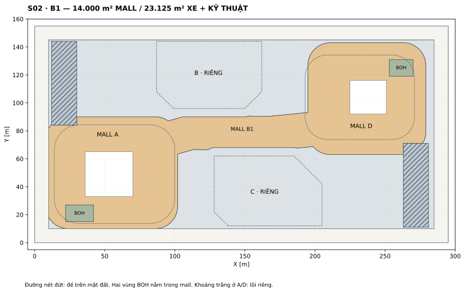

# 05 · Khối đế, mall và năm tầng hầm

| Tầng | Z | Cao | Tâm X | W | H | Bao sàn | Lỗ/cắt | Sàn kiểm soát |
| --- | --- | --- | --- | --- | --- | --- | --- | --- |
| A01 | 0,00 | 6,00 | 57,00 | 86,00 | 70,68 | 5.800,00 | 300,00 | 5.500,00 |
| A02 | 6,00 | 5,40 | 57,00 | 85,40 | 70,59 | 5.750,00 | 1.950,00 | 3.800,00 |
| A03 | 11,40 | 5,40 | 56,00 | 82,00 | 70,47 | 5.500,00 | 500,00 | 5.000,00 |
| A04 | 16,80 | 5,40 | 55,00 | 78,00 | 69,85 | 5.200,00 | 400,00 | 4.800,00 |
| A05 | 22,20 | 5,40 | 54,00 | 75,00 | 68,46 | 4.900,00 | 300,00 | 4.600,00 |
| A06 | 27,60 | 6,40 | 53,00 | 72,00 | 66,95 | 4.600,00 | 300,00 | 4.300,00 |
| D01 | 0,00 | 6,00 | 232,00 | 78,00 | 60,52 | 4.500,00 | 100,00 | 4.400,00 |
| D02 | 6,00 | 5,40 | 232,00 | 77,50 | 60,26 | 4.450,00 | 800,00 | 3.650,00 |
| D03 | 11,40 | 5,40 | 233,00 | 75,00 | 59,25 | 4.250,00 | 200,00 | 4.050,00 |
| D04 | 16,80 | 5,40 | 235,00 | 72,00 | 56,51 | 3.900,00 | 150,00 | 3.750,00 |
| D05 | 22,20 | 5,40 | 237,00 | 68,00 | 52,87 | 3.450,00 | 150,00 | 3.300,00 |
| D06 | 27,60 | 6,40 | 238,00 | 64,00 | 48,81 | 3.000,00 | 150,00 | 2.850,00 |

Tất cả đế A/D có tâm Y cố định lần lượt 49/104 m. Tâm X và kích thước thay đổi theo bảng. Bán kính và tọa độ đầy đủ trong JSON/CSV. Lỗ/cắt sàn được lưu bằng polygon: một phần là atrium, một phần là khoảng lùi hoặc thông tầng sảnh. Không mặc định tất cả diện tích này là giếng trời nằm giữa khối.

## Tiếp đất

Thân A có đường bao chân khoảng 4.360 m²; đường bao đế trên cùng 4.600 m². Thân D có đường bao chân khoảng 2.756 m²; đế trên cùng 3.000 m². Kiểm tra bao hình cho tất cả sáu tầng đế đã thực hiện. Các lỗ sàn vẫn có thể cho cột đi xuyên; không quảng cáo một sảnh hoàn toàn không cột khi chưa có giải pháp kết cấu.

Mép đế phía quảng trường lùi dần: A có phần vươn sang +X, D sang −X. Mặt tiền thấp, khoảng hiên và sân nhà hàng cần được triển khai theo chính các đường bao này. Hình R1 có độ lùi vừa phải do phần thân A khá lớn; ảnh phối cảnh với một podium rất rộng hoặc thân tháp rất mảnh ở chân không phải đường cơ sở.

## Phân bổ công năng đế — ngân sách, chưa phải NLA

| Khối | Mall và phụ trợ mall | Sảnh/lõi/phụ trợ tháp | Tổng |
| --- | --- | --- | --- |
| A | 21.000 m² | 7.000 m² | 28.000 m² |
| D | 17.000 m² | 5.000 m² | 22.000 m² |
| B1 | 14.000 m² phân khu mall | nằm trong vùng xe/kỹ thuật đối với lõi riêng | 14.000 m² mall |

Tổng quỹ mall 52.000 m² gồm cả giao thông và BOH, không phải diện tích cho thuê. Bố trí retail/F&B ở A01–A03 và D01–D03; các tầng cao hơn có thể có giải trí, ăn uống, dịch vụ và tiện ích tháp. Ballroom khách sạn nếu phát triển phải lấy từ quỹ 5.000 m² phụ trợ đế D hoặc điều chỉnh lại ngân sách rõ ràng.

## Hầm

| Tầng | Cốt sàn | Chiều cao danh nghĩa | Diện tích đường bao | Mall | Xe/kỹ thuật |
| --- | --- | --- | --- | --- | --- |
| B1 | −6,00 m | 6,00 m | 37.125 m² | 14.000 m² | 23.125 m² |
| B2 | −9,60 m | 3,60 m | 37.125 m² | 0 | 37.125 m² |
| B3 | −13,20 m | 3,60 m | 37.125 m² | 0 | 37.125 m² |
| B4 | −16,80 m | 3,60 m | 37.125 m² | 0 | 37.125 m² |
| B5 | −20,40 m | 3,60 m | 37.125 m² | 0 | 37.125 m² |

Cốt B5 không phải đáy đào hay đáy đài móng. Chiều cao danh nghĩa chưa trừ kết cấu sàn và MEP. Đường bao hầm lùi 10 m là giả định thiết kế, chưa phải chỉ giới được phê duyệt.

*S02 — Mall B1 và phần xe/kỹ thuật còn lại, dựng từ các polygon thực.*

## Hình học mall B1

Hai vùng đầu A/D là các đường bao rộng hơn đế trên mặt đất. Chúng nối qua vùng đệm quanh tim quảng trường; bề rộng tham số trước khi cắt là 24,60 m. Sau khi trừ đệm B/C, lõi A/D và vùng ram, polygon liên tục còn đúng 14.000 m². Độ rộng tại từng điểm thay đổi do các phép cắt; con số này không phải toàn bộ bề rộng hành lang đi bộ.

Hai lõi riêng trừ khỏi mall: A tại X=36..70, Y=33..65; D tại X=225..251, Y=92..116. Đệm sáu mét quanh footprint đế B/C không thuộc mall. Kết nối kiểm soát từ gara vào sảnh cư dân sẽ thiết kế trong vùng riêng; không mở một đường mall xuyên đế căn hộ.

## Ram, nhận hàng và giới hạn hiện tại

- R1: X=12..30, Y=84..144; R2: X=263..281, Y=11..71. Mỗi vùng 18×60=1.080 m², nằm ngoài mall và trong đường bao hầm.
- Đây là vùng giữ chỗ, chưa phải tuyến ram đã giải độ dốc. Dốc xuống B1 sâu 6 m cần kiểm tra chiều dài hữu dụng, đoạn chuyển, bán kính quay, cao độ qua dầm và khả năng vào/ra cùng lúc.
- BOH A: X=22..42, Y=15..27, 240 m². BOH D: X=253..270, Y=119..131, 204 m². Cả hai nằm trong polygon mall B1. Kích thước vùng này chưa chứng minh được khả năng quay xe tải; có thể dùng điểm nhận hàng xe nhỏ và tổ chức chuyển tải theo khung giờ.
- Chưa tính số chỗ xe. Phải trừ ram, lõi, phòng máy, đường xe, cột và vùng quay xe trước khi tính capacity.
- Chưa khoét sân chìm hay giếng trời xuyên bản đế ở R1. Các khoảng mở đó chỉ được bổ sung sau khi xác định vị trí cột, ram, phân khoang và chống thấm; mọi lỗ mới phải vào dữ liệu diện tích.

Hầm liên thông là liên thông xây dựng và giao thông có kiểm soát, không đồng nghĩa mọi nhóm sử dụng được đi xuyên mọi phân khu.
